# Auditoría crítica y forense completa (27-nov-2026)
## Por qué Motor City, Turno Cero, Juega EnCicla, El Metro y Run Scooter son malos juegos hoy — dónde fallan, qué se implementó mal y cómo salvarlos

> **Metodología (cero complacencia, cero fé en las bitácoras):**
> Todo lo que sigue fue verificado **directamente en el código fuente**, en los **HTML compilados** y **jugando y midiendo los cinco productos en Google Chrome 158 móvil (`412 × 860`, DPR 2, táctil, WebGL)** el 27 de noviembre de 2026. No se dio por cierto ningún `✅` ni ningún `"0 errores"` escrito por sesiones previas en `BITACORA.md`, `PROMPT-RELEVO.md` o `PEDIDO-DEL-AUTOR-2026-11-25.md`.
>
> **Nota de transparencia sobre FPS:** las mediciones en navegador se tomaron en una VM Linux con WebGL por software (SwiftShader), por lo que los FPS absolutos son más bajos que en una GPU dedicada de celular; **sin embargo**, los bloqueos del hilo principal (1,3–3,2 segundos), los 4+ *reflows* forzados por cuadro, el consumo de RAM (hasta **276,5 MB** de *heap* JS), los **30,1 MB** de HTML, los bugs de código, las cámaras rotas, el arte plano y los solapamientos visuales son **100 % reales e independientes de la GPU**.

---

## 0. Veredicto sin maquillaje: la enfermedad sistémica de los 5 proyectos

Estos cinco proyectos no son malos por falta de esfuerzo ni de horas: tienen **~47.000 líneas de JavaScript**, **369 archivos Markdown (6,54 MB de prosa de documentación)** y **~480 MB** en repositorios. Son malos juegos porque cayeron en **siete patologías estructurales** que convirtieron una gran idea (juegos colombianos sobre territorio real, sin internet) en un **Frankenstein injugable, feo, lento y sin diversión**:

1. **La mentira del «motor compartido» (150 MB de peso muerto):**
   `motorcity` **no mueve a ninguno de los tres juegos de familia**. Ni `BicicletasUno`, ni `MetroZero`, ni `RunRunZero` importan o ejecutan un solo byte de `dist/motor.js` en tiempo de ejecución. Cada uno lleva una copia muerta de **50 MB** de `motor-city/` («solo de consulta») y corre sobre **cuatro motores totalmente distintos e incompatibles** (Canvas 2D en EnCicla, WebGL propio de cubos en El Metro, Three.js + WebGL1 + Canvas 2D + Raster CPU en Motor City/Turno Cero, y otro WebGL1 propio en Run Scooter). Por eso cada pedido tuyo «se perdía» o terminaba parcheado de tres maneras incompatibles.
2. **Arquitectura de parches apilados («módulos aditivos» que nadie limpia):**
   Por miedo a tocar archivos viejos, las IAs fueron apilando capas encima de capas hasta quedarse sin letras del alfabeto: EnCicla tiene **100 archivos JS** hasta `99zz2-turismo.js` (con **28 parches que cargan DESPUÉS de `99-boot.js`** por orden ASCII y `Ride.prototype.update` parcheado **16 veces**); El Metro tiene **82 archivos JS** con `Libre.step` envuelto **9 veces** y `G3.draw` envuelto **5 veces**; Motor City tiene **88 archivos JS** con **8 pipelines de renderizado** y **4 motores de física de carros** conviviendo a la vez.
3. **Pruebas mentirosas («teatro de QA»):**
   Los cuatro repositorios presumen `"0 errores"` y `"todo en verde"`, pero **sus pruebas hacen trampa o son tautologías**:
   - En **Turno Cero**, `pruebas/getaway-historia.mjs` y `pruebas/modos.mjs` «ganan» el juego **teletransportando el carro** y poniendo `r.salud = 0` a los enemigos; `pruebas/medir.mjs` solo comprueba `p95 >= p50` (tautología matemática) sin techo de FPS.
   - En **El Metro**, `tools/test.mjs 100` corre con `EM.headless = true` (apaga WebGL, UI, audio e inputs reales) y **ni siquiera detectó que la Pausa está 100 % rota en todo el juego (`25-game.js:28`), que caminar está medio comentado (`36-libre.js:210`) ni que el multijugador cooperativo descarta el 100 % de las acciones (`80-multi.js:109`)**.
   - En **EnCicla**, la compuerta `benchmark-2km-gpt6.mjs` teletransporta la bici a `v = 0` con `dpr = 1` y **no exige `terminados > 0`** (0 trozos cargados aún da `META CUMPLIDA`), mientras `revolucion-encicla.js` **prohíbe limpiar la interfaz** exigiendo `>= 21` opciones y `>= 17` minijuegos.
   - En **Run Scooter**, `sim.mjs` nunca carga el renderizador ni los modelos: pasó con 0 errores mientras **el 100 % de las vallas de la ciudad están tapadas por su propia tabla trasera (`models.js:121-123`)** y **las montañas de 30 metros se mecen con el viento separándose de su nieve (`engine.js:119`)**.
4. **Fantasía insostenible del «HTML único gigante» para celulares modestos:**
   Querer meter 3 ciudades enteras + 640.000 edificios + Three.js + 45 GLBs + imágenes WebP en Base64 dentro de un solo archivo produjo un **`getaway.html` de 30,12 MB**, un **`juega-encicla.html` de 10,02 MB** y un **`El Metro` de 9,24 MB** que consumen entre **85 y 276 MB de heap JS** y congelan el hilo principal segundos enteros al arrancar.
5. **Cantidad en vez de diversión (síndrome de menú infinito):**
   En vez de pulir **un** bucle central que se sienta sabroso al segundo 3, todos los juegos amontonan entre 11 y 28 modos/minijuegos superficiales (de 80 líneas cada uno), 16 botones simultáneos en pantalla, avisos apilados que tapan el centro y cero *game feel*.
6. **Gráficos de programador sin dirección de arte real en el mundo:**
   Pese a cientos de páginas sobre arte, el mundo jugable real de los cinco productos son cajas planas sin textura, círculos concéntricos pintados en el suelo para los árboles, sombras grises borrosas, carreteras sin detalles, texto recortado y *dithering* tipo estática de televisor.
7. **Burocracia multi-IA (más prosa que juego):**
   Hay **6,54 MB de documentos Markdown** (232 solo en `motorcity`), planes de evolución rivales de cada modelo, archivos de entrega de **87 MB y 50 MB metidos en Git**, e incluso nombres internos de IAs (`Codex`) expuestos directamente al jugador en la portada de Turno Cero.

---

## 1. Radiografía numérica comparativa (medida el 27-nov-2026)

| Métrica | Motor City (banco) | Turno Cero (`getaway.html`) | Juega EnCicla (`3.11.0`) | El Metro (`3.12.0`) | Run Scooter (`2.5.0`) |
|---|---:|---:|---:|---:|---:|
| **Tamaño del HTML único** | 13,46 MB (`motor.js`: 4,33 MB) | **28,73 MiB (30,12 MB)** | **9,79 MiB (10,27 MB)** | **9,04 MiB (9,47 MB)** | 0,46 MB (469 KB) |
| **Código real del juego dentro del HTML** | 1,22 MB (88 archivos) | **314 KB (1,1 % del archivo)** | 1,62 MB (100 archivos) | 1,18 MB (82 archivos) | 338 KB (10 archivos) |
| **Copia muerta de `motor-city/` en el repo** | *(es la fuente)* | *(vive aquí)* | **50 MB (0 % usada)** | **50 MB (0 % usada)** | **50 MB (97,5 % del repo)** |
| **Heap JS medido en Chrome móvil** | 149,8 MB | 85,6 MB (al entrar) | **157,7 – 166,9 MB** | **276,5 MB** | 11,1 MB |
| **Botones visibles en juego (`412×860`)** | 9 (texto sangra bajo botones) | **16 en juego / 11 en portada** | 9 en libre (14 parches en `Más`) | **17 en libre (13 < 44 px!)** | 3 en juego / **12 en portada (8 < 44 px)** |
| **Picos de cuadro / congelones (SwiftShader)** | 1.250 ms (2,0 FPS) | **3.226 ms (0,3 FPS al abrir)** | **1.967 ms portada / 1.900 ms libre** | **1.383 ms libre / 783 ms conduce** | 417 ms portada / 250 ms juego |
| **Documentos Markdown en el repo** | **232 archivos (3,83 MB)** | *(en `motorcity`)* | 56 archivos (1,51 MB) | 68 archivos (1,16 MB) | 13 archivos (47 KB) |

---

## 2. Evaluación implacable de lo pedido por el autor (`PEDIDO-DEL-AUTOR-2026-11-25.md`)

Las bitácoras dicen que buena parte de tus pedidos **P1–P13** ya quedaron `✅`. **La verificación en código y pantalla demuestra lo contrario:**

| # | Qué pediste literalmente | ¿Implementado? | ¿Bien o mal? | Veredicto forense comprobado |
|---|---|---|---|---|
| **P1** | **Mundo enteramente 3D** jugado en cenital | **NO** en EnCicla · **A medias** en Turno Cero y El Metro | **MAL** | **EnCicla es 100 % Canvas 2D plano** (de hecho `99zz-camara-unica.js` **mató** el único WebGL `Mundo3D` en juego). **Turno Cero** cae a 2D plano en GPUs suaves y usa un suelo 2D con overlays 2D. **El Metro** son cubos planos sin textura sobre un suelo pintado en 2D. |
| **P2** | **Una sola cámara** centrada, acercable hasta casi 3.ª persona; **eliminar las demás cámaras** | **PARCIAL** (parcheado a las malas) | **MAL** | **No eliminaron ninguna cámara**, solo escondieron botones (`display:none!important`). **EnCicla** deja **13 botones zombis de cámaras** en `Más`, `⬢ Maqueta 2:1` vivo en el mapa y al acercar a 2,7× solo estira y gira el 2D plano (las casas quedan patas arriba). **El Metro** deja 5 radios muertos en Ajustes, selectores de 6–7 cámaras en 4 modos y un clamp en `96g-ladeo-mitades.js:210` (`3.2 < 3.6`) que **impide llegar a casi 3.ª persona pellizcando**. **Turno Cero** desactiva casi 3.ª persona sin GPU dedicada, carece de *spring-arm* (la cámara atraviesa edificios y lomas) y `historieta` rompe el perfil cenital. **Motor City (`motor-city.html` y `mandados.html`)** sigue mostrando el botón `🗺️ Vista`. |
| **P3** | **Nada pintado en el suelo** (edificios, árboles, carros, postes 3D reales) | **NO** (pendiente en papel, **roto** en los 3 juegos) | **PÉSIMO** | **EnCicla:** casas de 1–2 pisos, árboles (4 círculos concéntricos), postes, bancas, hitos, estaciones y los 5 skateparks siguen pintados planos en el suelo. **El Metro 3D:** 0 semáforos, 0 postes, 0 bancas, 0 cebras, 0 árboles de avenidas, y Plaza Botero/Pies Descalzos/Parque de las Luces son **invisibles** (`22-gl.js:262`). **Turno Cero:** el mobiliario (`27-mobiliario.js`) **nunca se dibuja en 3D, pero SÍ tiene colisión (`15-terreno.js:109`)**: te estrellas contra postes y bancas invisibles mientras charcos, conos, plazas y sombras siguen pintados en 2D. |
| **P4** | **2D y pixel solo en modos ya establecidos** | **NO** | **MAL** | EnCicla corre su mundo entero en 2D; el Bus de El Metro (`38-bus.js`) sigue en 2D; Turno Cero en GPU baja cae a 2D plano. |
| **P5** | **Mejores detalles y texturas en los gráficos del mundo** | **NO** | **PÉSIMO** | El Metro tiene **0 % de texturas IA** en su mundo 3D (y 16 PNGs faltantes en `96i-arte-36.js`). EnCicla tiene **0 texturas** en su mundo. Run Scooter tiene solo **3,4 %** de vértices texturizados y **100 % de sus vallas tapadas**. Turno Cero embebe 1,73 MB de fachadas de Medellín, pero en Manhattan genera 10.000 triángulos sin textura por edificio y arranca en un desierto beige borroso. |
| **P6** | **Carga del mundo completa y fluida sin huecos** | **PARCIAL** (solo parches en EnCicla y El Metro; **NO** en Turno Cero) | **MAL** | **EnCicla (`99w`):** reemplaza huecos por **sopa borrosa de 8×8 píxeles** que salta bruscamente al terminar, y congela el hilo principal descomprimiendo 4,4 MB de `EDIF_BIN` (`99z:25-33`). **El Metro (`97e`):** sigue subiendo un canvas `2048×2048` síncrono en el cambio de ventana (~440–645 ms) y se congela entero si avanzas rápido (`97e:67`). **Turno Cero (`45-tres.js:242`):** tiene un bug inverso fatal — al acercarte a casi 3.ª persona **achica el radio de carga a 140 m** justo cuando miras más lejos, apaga PVS y *frustum culling* en cenital, y borra todo el mundo cada 2,5 km (`45-tres.js:237`). |
| **P7** | **Fluidez del movimiento** (EnCicla como vara; Turno Cero al nivel) | **NO** | **MAL** | **Ninguno usa paso fijo con interpolación** (`MC.Bucle` existe en `motorcity/js/05-gpu.js:123` y **0 juegos lo usan**). EnCicla hace **4+ reflows DOM por cuadro** (`60-ui.js:430-442`). El Metro tiene el caminar medio comentado (`36-libre.js:210`) y lag de cámara dependiente de FPS (`* .06`). Turno Cero hace blit síncrono WebGL→2D cada cuadro y retransforma todos los vértices GLB en CPU. |
| **P8** | **La música no debe seguir sonando al salir de la app** | **SÍ** en 3 · **NO** en Run Scooter | **REGULAR** | `01-sonido-guardian.js` / `00b-sonido-guardian.js` suspende `AudioContext` en EnCicla, El Metro y Turno Cero (verificado en Chrome). **Pero:** **Run Scooter nunca lo recibió**; en los otros 3, los `setInterval`/`setTimeout` musicales siguen corriendo en segundo plano, en El Metro los *hi-hats* salen por el canal SFX y siguen sonando con la música apagada (`00-core.js:135,193`), en EnCicla la música del menú muere al volver de pestaña, y en Turno Cero `MC.Paisaje` sigue encolando osciladores en segundo plano. |
| **P9** | **Bug de portada de EnCicla (animación no cargaba)** | **PARCHEADO** | **MAL** | `98z-portada-viva.js` es un parche cosmético con un `<div>` encima mientras `20-map.js` sigue congelando el hilo principal **~2–8,6 s** (medimos **1,6 FPS / 1.967 ms** justo en la portada). |
| **P10** | **Controles personalizables, sensibilidad, esquemas y recomendación vertical/horizontal** | **NO** | **NO EXISTE** | **0 % implementado** en los 4 repositorios. Ni curvas de sensibilidad, ni esquema de deslizar, ni opacidad/tamaño libre, ni **una sola línea** de recomendación vertical vs. horizontal. |
| **P11** | **Botón 🏆 Escalafón en portada de EnCicla** | **SÍ** | **REGULAR** | Existe en portada (`#bOficios`), pero al entrar por primera vez `80-limpieza.js:125-127` secuestra la pantalla con el modal de crear ciclista. |
| **P12** | **Lámina «Un día en EnCicla» (apertura y cierre)** | **⏸ Solo plan** | **OK (respetado)** | Correctamente detenido a la espera de tu OK y permiso de marca. |
| **P13** | **Modo turismo de la ciudad y estaciones** | **SIMULADO** | **MAL** | **No es un modo de juego.** Es un modal HTML de 78–87 líneas con 12 fichas recicladas de `LUGARES`, un minimapa borroso de `150×190 px` y un botón que **te teletransporta a la estación sin ponerte ni flecha, ni ruta, ni misión hacia el sitio turístico** (en El Metro `97f-turismo.js:76-78` además te puede soltar dentro de un edificio o arriba de tu vehículo anterior). |

---

## 3. Auditoría profunda por producto

---

### 3.1 MOTOR CITY (`motorcity` + `motor-valle`) — El motor que nadie usa

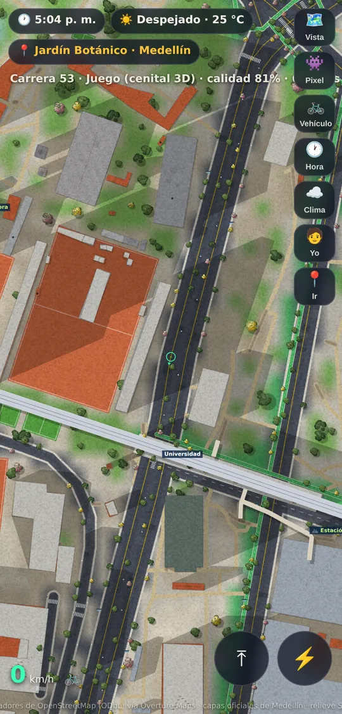
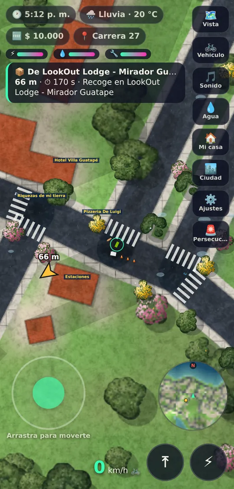

*Arriba: `motor-city.html` (texto `Carrera 53 · Juego (cenital 3D) · calidad 81%` sangrando debajo de `👾 Pixel`, botón `🗺️ Vista` vivo, atribución cortada en ambos bordes, aspecto 100 % plano a 2 FPS y 149,8 MB RAM) y `mandados.html` (cebras cruzadas en la intersección derecha, barras con degradado neón cian-magenta que violan la propia skill `motor-city-diseno-ui`, botón `Persecuc...` truncado, `🗺️ Vista` vivo, edificios y árboles planos).*

#### Dónde falla técnicamente
1. **Es un motor de papel:** `BicicletasUno`, `MetroZero` y `RunRunZero` **no ejecutan `dist/motor.js`**. Solo comparten el *pipeline* de datos Python `motor-valle/` (entre EnCicla y El Metro), y ni siquiera usan `motor-valle/js/valle.js` en runtime.
2. **4,54 MB de `motor.js` sin *tree-shaking* ni minificación:** el 40,1 % (`1,73 MiB`) son fachadas de Medellín en Base64 metidas a la fuerza en **todo** juego; el 16,3 % (`705 KB`) son 18 WebP de biomas arcade; el 15,2 % (`659 KB`) es Three.js 0.170 empaquetado cortando `export{` con `lastIndexOf`; y decenas de módulos (`13-cosmos`, `48-interiores`, `49-hogar`, `26-urbe`, `03-economia`, `35-seres`, `85-historias`, `86-necesidades`, `87-pieles`, `89-exportar`, `90-three`, `92-publico`) van de lastre en cada compilación.
3. **8 renderizadores y 4 físicas de carro en el mismo archivo:** `41-vista2d`, `43-panoramica`, `44-raster` (rasterizador 3D por CPU), `45-gl`/`45-gl3d`, `45-tres` (Three.js), **`90-three` (segundo Three.js duplicado y muerto!)**, `47-pista`/`47-clasicos` y `run/run-scooter.js`. En física conviven `_paso`, `_arcade`, `36-taller.js` (muerto porque exige `manejo === 'simulacion'` que ya no existe en `37-flexibilidad.js:24`) y `37-dinamica.js` (hasta 40 subpasos por cuadro en lag).
4. **4 capas de monkey-patching sobre `VistaTres` y `Vistas`:** `45-tres` → `45-y-sitios` → `45-z-r6b` (apagado por lento) → `47-historieta` (que literalmente muta `MC.opciones.graficos = 'realistas'` dentro de `hayGL()` en la línea 294 para engañar a la clase base).
5. **Cuellos de botella letales en el render 3D (`45-tres.js`, `46-vistas.js`):**
   - `46-vistas.js:78` copia cada cuadro el framebuffer WebGL al canvas 2D con `dst.drawImage(cv, ...)` (lectura GPU→2D síncrona).
   - `45-gl.js:164-190` / `45-glb.js:125-147` / `45-tres.js:279-289`: **cero instanciado GPU**; transforma cada vértice de cada GLB y peatón (~120 triángulos c/u) en CPU con JS `d.push(...)` y sube un buffer nuevo cada cuadro.
   - `45-tres.js:243-246`: cruzar distancias `600 → 300 → 170 → 100 m` **destruye y reconstruye** la región entera y rasteriza una losa `1024×1024` síncrona en el hilo principal; cada 2,5 km (`45-tres.js:237`) hace `this.liberar()` y **borra toda la ciudad**.
   - `45-tres.js:270-271`: desactiva *frustum culling* y PVS en vista aérea (o sea, **siempre** con la cámara única).
   - **Mobiliario fantasma:** `27-mobiliario.js` nunca se dibuja en 3D, pero `15-terreno.js:109` colisiona con él y `26-vida-ciudad.js:106` sienta peatones en bancas invisibles.
   - `MC.Bucle` (`05-gpu.js:123`, paso fijo + interpolación + *hitstop*) está escrito pero **ningún juego lo llama**.
6. **218 MB de `dist/` metidos a Git:** incluye `ENTREGA-CODEX-TURNO-CERO.html` (**87 MB**) y `ENTREGA-MOTOR-CITY-2.7.1.html` (**50 MB**).

#### Por qué falla como producto
Un motor existe para que hacer juegos sea **más rápido, más liviano y más consistente**. Motor City hizo exactamente lo opuesto: engordó 300 MB, nadie lo usa para los juegos principales, y obliga a arrastrar una ciudad entera y 8 renderizadores para mover una bici o un carro.

---

### 3.2 TURNO CERO (`motorcity/juegos/getaway/`) — 30 MB de confusión y desierto borroso

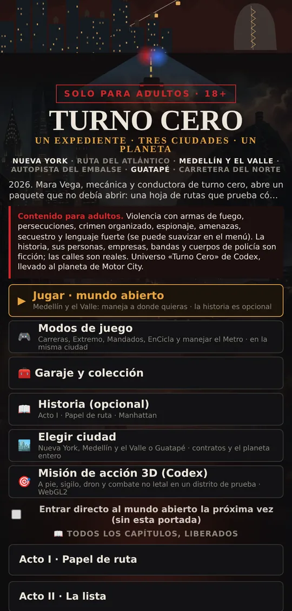
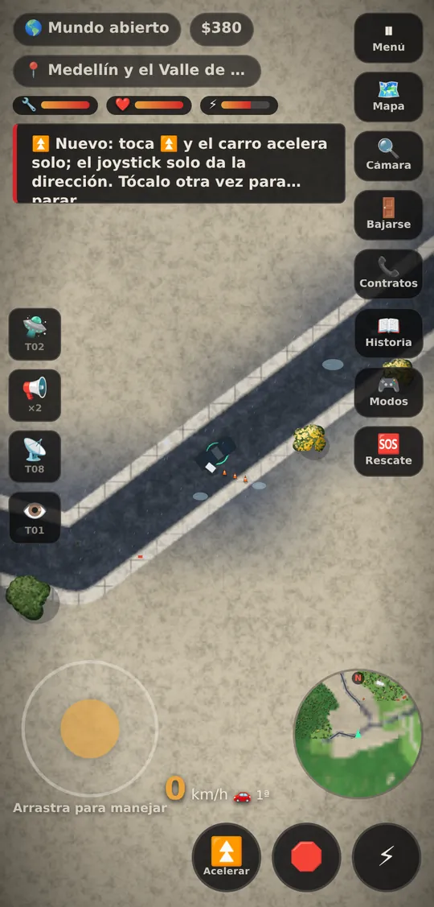
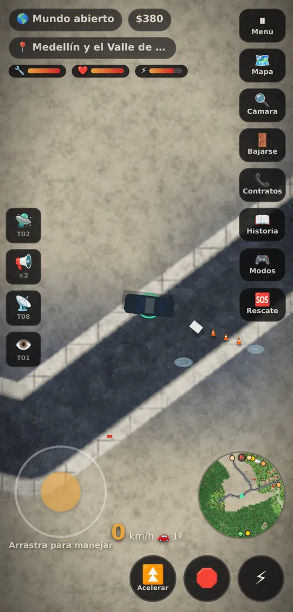
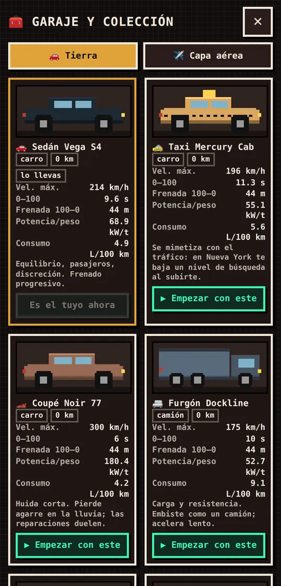

*Arriba: (1) Portada con 11 botones (3 cortados), sinopsis truncada a media palabra (`prueba có...`) y menciones técnicas internas expuestas al jugador (`Universo «Turno Cero» de Codex`, `Misión de acción 3D (Codex)`). (2) Al darle «Jugar · mundo abierto», el carro aparece en un baldío beige borroso sin edificios ni tráfico, rodeado de **16 botones**, artefactos crípticos (`T02`, `T08`, `T01`) y el cuadro de aviso cortando la última línea de texto por la mitad (`parar`). (3) Al hacer zoom máximo sigue siendo 2D plano borroso con un rectángulo oscuro de carro, 3 conos y 2 charcos pintados. (4) Garaje con cajas pixeladas de 1995 donde los cuatro vehículos (del cupé de 300 km/h al furgón de carga) tienen exactamente `Frenada 100–0: 44 m`.*

#### Dónde falla técnicamente
1. **30,12 MB para que el código del juego sea apenas el 1,1 % (314 KB):** el 78 % del HTML son las 3 ciudades completas (solo edificios de Manhattan = **9,71 MiB**), más 4,59 MiB de `motor.js` + una copia entera de **Run Scooter** (278 KB), más **25 modelos GLB (136 KB) que jamás se usan en código**.
2. **Al entrar al juego se congela 3,2 segundos (`0,3 FPS` medidos)** y al alejar la rueda del ratón llega a colgar el hilo principal.
3. **Colapso visual en GPUs modestas / software:** cae a un 2D plano y feísimo, **deshabilita "casi tercera persona"** (`90-inicio.js:50`) y el jugador aparece en una calle solitaria en medio de un páramo beige borroso.
4. **Cámara sin colisión ni rayos X en Three.js:** `_aereo()` (`34-camara.js:102-124`) no tiene *spring-arm*, así que en 3D real al acercarse atraviesa edificios y cerros; y `45-tres.js` **no tiene *occluder fade*** (lo que la auditoría previa marcó como `✅ Rayos X` solo existía en 2D y en el WebGL1 de respaldo).
5. **Bugs concretos en código:**
   - `57-cine.js:41-43` mueve al jugador (`C.x = nx; C.y = ny`) **dentro del callback de dibujo**, saltándose las colisiones.
   - `40-dibujo.js:92,101,108` anima humo/pulsos con `+= 1/60` fijo en render.
   - `70-interfaz.js:110` fuerza un *reflow* (`getBoundingClientRect`) en cada cuadro justo después de escribir `vel.innerHTML`.
   - `60-musica.js:104,110` crea ~9 `AudioBuffer` de 53 KB y `WaveShaperNode` nuevos por segundo en el hilo principal; el motor del carro (`20-juego.js:36`) es un zumbido constante de onda sierra cruda.
   - `turno-cero-accion-3d.html` dispara un error `404` en consola, muestra teclas de PC (`WASD/V/E/F/Q/R/G/C`) en celular y es una demo desconectada que ni comparte guardado ni mundo.
   - El cuadro de avisos recorta verticalmente la última línea en casi todos los mensajes (`tc_02`, `tc_03`, `tc_cam_step1/2/3`).

#### Por qué NO es divertido
- **Crisis total de identidad:** se vende como un *thriller* 18+ de crimen y espionaje (*GTA Chinatown Wars* / *Reckless Getaway*), pero por dentro te mete **minijuegos familiares de inflar llantas y aceitar cadenas de EnCicla (`64-minijuegos.js`)**, **Run Scooter**, **Mandados**, **manejar el Metro**, **laboratorio de química**, **3 motores de carreras distintos** y una demo 3D aparte de Codex. Es una feria de experimentos sin alma.
- **Bucle central plano y aburrido:** ir del punto A al punto B (`d < 18 m`), leer un modal de texto, darle a 1 botón de opción. El combate es *hitscan* auto-apuntado de un botón; el sigilo son conos 2D; el «puentear» un carro es un popup opcional que ni siquiera te impide arrancar de inmediato.
- **Sobrecarga cognitiva inmediata:** en el segundo 1 te tiran **16 botones** encima (`T02`, `T08`, `T01`, `Bajarse`, `Contratos`, `Historia`, `Modos`, `Rescate`, `Cámara`, `Mapa`, `Menú`, `Acelerar`, freno, turbo, joystick, minimapa) y un menú de pausa de **18 botones** que incluye `"📏 Medir el rendimiento (60 s, para el autor)"`.

---

### 3.3 JUEGA ENCICLA (`BicicletasUno` v3.11.0) — 100 archivos de parches en 2D plano

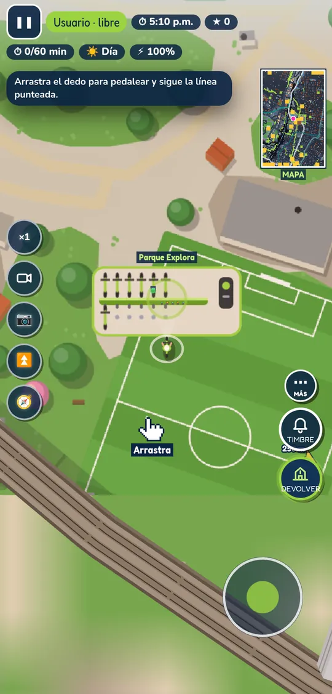
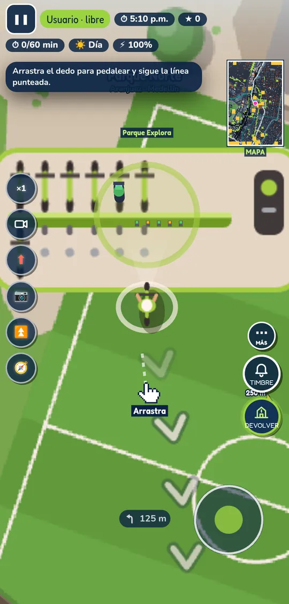

*Arriba: (1) Al tocar «Jugar» en EnCicla 3.11.0, la estación «Parque Explora» aparece **plantada en mitad de una cancha de fútbol**; las mitades superior e inferior izquierda son **sopa borrosa de 8×8 píxeles** sin cargar; la distancia (`250 m`) queda escondida detrás del botón `TIMBRE`; y todo es 100 % 2D plano pintado en el suelo. (2) Al acercar a «casi tercera persona» (`2,7×`), solo se estira el lienzo 2D pixelado y borroso sin nada de 3D.*

#### Dónde falla técnicamente
1. **Caos de orden de carga y parches encadenados (`tools/build.js:10`):** el `.sort()` ASCII hace que **`99-boot.js` se ejecute ANTES de 28 archivos de parches (`99a-fluidez.js` hasta `99zz2-turismo.js`)**. Solo no explota por un `await` accidental de un `requestAnimationFrame`. Peor: **`Ride.prototype.update` está parcheado 16 veces (17 capas por cuadro)**; `drawGround`, `UI.renderMas`, `actions` y `Game.start` están parcheados **14 veces**; y `99v-rendimiento.js:127-132` **parchea y desparchea `M.lotes` dentro de `draw3D` 60 veces por segundo**.
2. **4+ *reflows* DOM forzados cada cuadro a 60 FPS (`60-ui.js:430-442` + `88-camara.js:129-136`):** `Game.layout()` corre en cada *frame*, lee `getBoundingClientRect()`, escribe `document.documentElement.style.setProperty('--toastTop', ...)` (invalidando estilos de todo el documento), vuelve a leer `getBoundingClientRect()` y llama `getComputedStyle(documentElement)`.
3. **10,02 MB de HTML y 157–167 MB de RAM:** **4,20 MiB (42,9 %)** es `EDIF_BIN` (625.880 huellas que solo usa Modo Libre y que `99z-huellas.js:25-33` descomprime de golpe en JS bloqueando el hilo principal). En la portada medimos **1,6 FPS / 1.967 ms**; en Modo Libre **1,2–1,5 FPS / 1.350–1.900 ms**.
4. **Falso 3D y cámara rota (`99zz-camara-unica.js`):**
   - No eliminó las cámaras: puso `display:none!important` y dejó **1.237 líneas de WebGL muerto** más **13 botones zombis de cámaras en `Más`** y `⬢ Maqueta 2:1` vivo en el mapa.
   - Al acercar a `2,7×` solo agranda y rota el Canvas 2D; las casas de 1–2 pisos (con fachada fija hacia el sur en `75-graficos.js:383`) **quedan patas arriba cuando pedaleas hacia el sur**.
5. **Teclado roto en minijuegos nuevos:** `MGMetro2D` (`99p:912-915`) y `MGPalmas` (`99p:1042`) tienen `keydown` sin `keyup`: el acelerador o el freno quedan pegados para siempre.
6. **HUD con texto encimado:** `Parque Norte / Aranjuez` se transparenta detrás del cartel azul de instrucciones; `250 m` queda oculto detrás de `TIMBRE`; el menú de Pausa recorta el último botón (`Terminar práctica`).
7. **Pruebas que protegen la basura:** `tests/revolucion-encicla.js:456-457` falla si reduces `Más` a menos de 21 opciones o quitas alguno de los 17 minijuegos.

#### Por qué NO es divertido
- **Oficios que se sienten como formularios de oficina:** contar 5 bicis y apretar 1 de 3 botones (`MGConteo`), oprimir 7 cajas y comparar dos números impresos (`MGBodega2`), un quiz de servicio al cliente con respuestas bobas (`MGLlamadas`), una barra de 3,6 s con un botón `Adelantar` (`MGRutina`).
- **Minijuegos de humo vendidos como grandes géneros:** `MGPlaneador` («Cities: Skylines») es tocar 6 círculos sobre un fondo azul vacío durante 8 segundos; `MGMetro2D` («Tiny Rails») es imposible de perder; `MGPalmas` («Ley 1811») no tiene mecánica de distancia lateral — es solo texto en el título; los 5 «skateparks» son rectángulos en el piso que disparan `50-50 Grind +10` automáticamente con solo pasarles por encima.
- **Progresión destruida:** `99a-fluidez.js:75-76` enciende `JE.debugUnlock = true` por defecto (`Todo liberado`), matando el sentido de desbloquear oficios, estrellas o tienda.
- **Turismo de mentira:** un popup de tarjetas que te suelta en una estación sin siquiera marcarte cómo llegar al sitio turístico que elegiste.

---

### 3.4 EL METRO (`MetroZero` v3.12.0) — Pausa rota, caminar roto, coop roto y estática en 3D

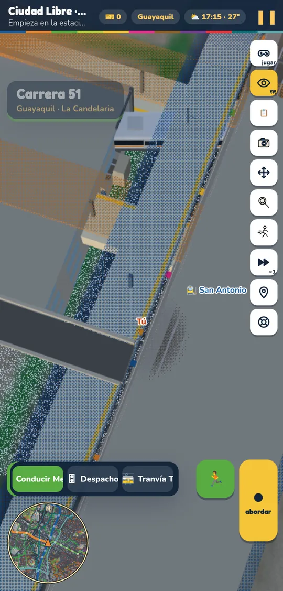
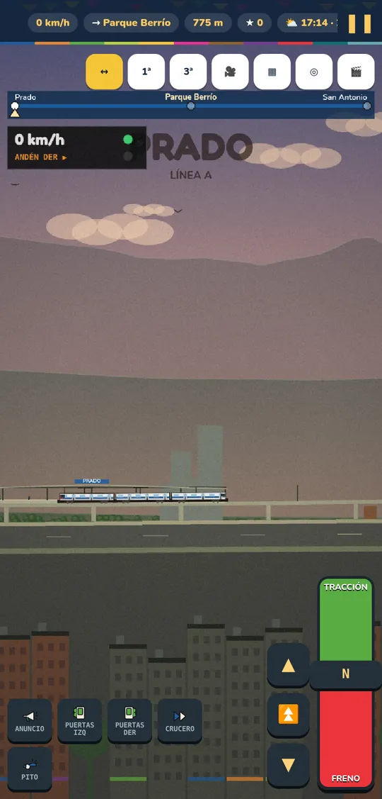

*Arriba: (1) Ciudad Libre en San Antonio nada más dar «Jugar»: **media pantalla cubierta por un tramado ajedrezado horrible** (`occluder fade`), el resto es un **vacío gris liso sin calles, árboles ni edificios**, el jugador es un punto naranja diminuto (`Tú`), **10 botones blancos sin etiqueta** a la derecha (13 de 17 botones en pantalla miden `40×38 px`, por debajo del mínimo táctil de 44 px) y la barra inferior corta `Conducir Me` y `Tranvía T`. (2) En Conduce el Metro, el velocímetro tapa la `P` de `PRADO`, el reloj se recorta contra Pausa y siguen vivos 7 botones crípticos de cámara.*

#### Dónde falla técnicamente (bugs gravísimos que pasaron `"0 errores"`)
1. **LA PAUSA ESTÁ 100 % ROTA EN TODO EL JUEGO (`src/js/25-game.js:28`):**
   ```js
   let dt = M.substeps ? Math.min(.2, raw) : Math.min(.05, raw);   // 3.6: hasta 0,2 s ... if (this.paused) dt = 0;
   ```
   Un comentario `//` en la misma línea **comentó `if (this.paused) dt = 0;`**. Cuando pausas el juego, la simulación, el tráfico, los relojes y los trenes **siguen corriendo a toda velocidad detrás del menú**.
2. **CAMINAR ESTÁ MEDIO COMENTADO (`src/js/36-libre.js:210`):**
   ```js
   st.wv = w0 + (spd - w0) * (1 - Math.exp(-dt * ...));   // 3.1 · igual a cualquier ritmo ... if (st.wv < .03) st.wv = 0; st.vf = st.wv; if (!st.wv) return;
   ```
   Exactamente el mismo bug `//`: `st.vf` nunca se actualiza a pie y `walk()` jamás retorna cuando estás quieto.
3. **EL MULTIJUGADOR COOPERATIVO ESTÁ 100 % ROTO EN LOS 4 MODOS (`src/js/80-multi.js:109`):**
   Solo acepta `typeof m.a === 'number' || typeof m.a === 'string'`, pero los 4 modos cooperativos (`40-rieles`, `45-metroplus`, `50-cable`) envían objetos (`{k:'sw',i}`). El anfitrión descarta silenciosamente el 100 % de las jugadas del invitado.
4. **EL RESPALDO 2D, «MEDIR MI CELULAR» Y EL PROPIO BENCHMARK DEL REPO MIENTEN (`36-libre.js:43`, `96d-rendimiento.js:30,42`, `tools/rendimiento-cenital.mjs:22,33`):**
   `Libre.vista(st, v)` fuerza `v = 'cen3d'` ignorando el parámetro `v`. Si el celular va lento, sale un aviso diciendo que bajó a 2D mientras sigue en 3D; «Medir mi celular» mide 3D dos veces y etiqueta la primera como 2D.
5. **PELLIZCAR NO PUEDE LLEGAR A CASI 3.ª PERSONA (`96g-ladeo-mitades.js:210`):**
   `36-libre.js:39` exige `zoomU = 3.6`, pero `96g` recorta el pellizco en `3.2`. Además la rotación de cámara `cyC` usa `* .06` sin `dt` (`36-libre.js:670`).
6. **276,5 MB DE HEAP JS Y PARONES DE ~440–1.383 ms:**
   `97e-ventana-por-partes.js` sigue subiendo un canvas `2048×2048` síncrono en el cambio de ventana, reconstruye 20.000 cotas de golpe, hace un bucle de emergencia síncrono si vas rápido (`97e:67`), y `22a-gpt6-eon-3d-batch.js:32-47` asigna cientos de `new Float32Array(16)` cada cuadro.
7. **ARTE 3D DE CAJAS SIN TEXTURA Y 16 PNGs FANTASMA:**
   Todo el 3D son cajas `G.box` sin textura; `22-gl.js:262` oculta Plaza Botero, Pies Descalzos y Parque de las Luces; el 100 % de `28-taller-ciudad.js` y `28-taller-estacion.js` (donde sí había agujas, estaciones y huellas reales) **es código muerto jamás llamado en juego**; `96i-arte-36.js` pide 16 imágenes que no existen en `src/data/arte.js`; y apagar la música deja sonando los *hi-hats* por el canal SFX (`00-core.js:135,193`).
8. **Parches que no hacen nada o chocan:** `96-arcade.js:58-65` y `96k-taller-bici.js:117` modifican `acc` que nadie lee; `38-bus.js` promete bono `×1,25` que nunca suma; hay **dos lanzadores de actividades duplicados** (`36c` y `97b`), **dos controles crucero** (`acelFijo` y `crucero`) y **dos modos historia de Rosalba distintos con guardados separados** (`70-historia.js` y `37-trama.js`).

#### Por qué NO es divertido
- **15+ prototipos pegados con cinta sin un solo juego redondo:** tres simuladores de bus redundantes (`38-bus`, `32-volante` que se atascaba tanto que le metieron teletransporte de desatasco, y el oficio de Ciudad Libre); Metrocable es deslizar una barra esperando fotos; Puzle del Cable, Despacho y Metroplús son clones abstractos genéricos sin alma paisa; Conduce el Metro es una palanca 1D con estética gris triste.
- **Ciudad Libre frustra desde el primer segundo:** apareces tapado por estática ajedrezada en un suelo gris vacío, rodeado de 10 íconos sin explicación, te interrumpen popups de crónicas cada 20 s y un 40 % de probabilidad de que se te pinche la bici frenando (`96k-taller-bici.js:132`), y si pausas el juego, **el juego ni siquiera se pausa**.

---

### 3.5 RUN SCOOTER (`RunRunZero` v2.5.0 y `motorcity/js/50-run.js`) — El más limpio, saboteado por bugs visuales y de *game feel*

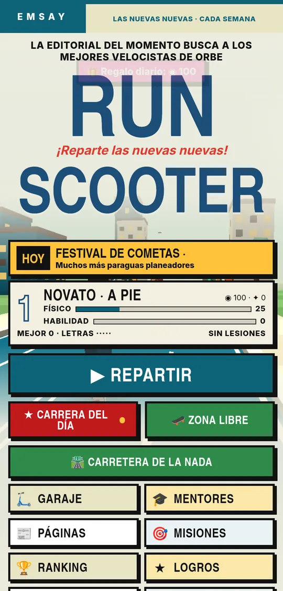
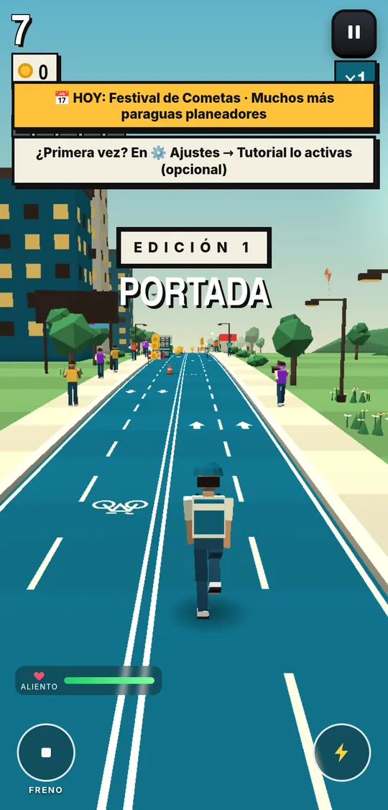

*Arriba: (1) Portada saturada con **12 botones** (8 menores a 44 px, 2 cortados abajo) y el aviso rosa `🎁 Regalo diario: ◉ 100` **pegado detrás de las letras `RUN`**. (2) En plena carrera, **3 carteles gigantes simultáneos tapan la mitad superior de la pista y del HUD** (`HOY: Festival de Cometas`, `¿Primera vez?...`, `EDICIÓN 1 / PORTADA`), mientras a la izquierda se ve el bug fatal del motor 3D: **una valla marrón completamente en blanco** porque su marco tapa su propio dibujo.*

#### Dónde falla técnicamente
Aunque Run Scooter es el único juego arquitectónicamente sano (469 KB, 11 MB de RAM, sin los 100 archivos de parches), tiene fallas absurdas que arruinan la experiencia y nunca se arreglaron (lleva 18 commits seguidos sin tocar `src/`, solo copiando **50 MB** de `motor-city/` que jamás usa):
1. **EL 100 % DE LAS VALLAS PUBLICITARIAS ESTÁN TAPADAS POR SU PROPIA TABLA (`src/models.js:121-123`):**
   `billFrame()` pone una caja opaca en `z ∈ [0,00, +0,12]` **delante** del plano con textura `billPanel()` en `z = 0,00`. Las 14 vallas de EMSAY y eventos se ven como **rectángulos marrón oscuro vacíos** (visible en la captura de arriba).
2. **LAS MONTAÑAS DE 30 METROS SE MECEN CON EL VIENTO Y SE DESPEGAN DE SU NIEVE (`src/engine.js:119`, `src/models.js:288`):**
   El shader del viento de árboles mueve cualquier vértice con `aC.r < 0.06 && aP.y > 0.9` — condición que cumplen las montañas (`PC(0)` hasta `y = 29 m`), pero NO sus picos nevados (`PC(3)`).
3. **TRAMPA MORTAL ANTI-BUFFERING EN LOS CONTROLES (`src/game.js:443-448, 606`):**
   Tiene **cero *coyote time*** y **cero búfer de salto**. Peor aún: si deslizas `↑` apenas 50–150 ms antes de tocar el suelo (la memoria muscular normal de *Subway Surfers*), dispara un truco aéreo y al aterrizar `<0,22 s` después **te hace tropezar o te mata por «truco incompleto»**.
4. **HIELO INVISIBLE QUE APAGA EL CONTROL (`src/game.js:440, 658`):**
   Pisar hielo bloquea todo giro izquierda/derecha por `1,1 s` con **cero sonido, cero partículas y cero aviso en HUD**. El jugador cree que la pantalla táctil dejó de responder.
5. **HITBOX ÚNICO DE PEATÓN PARA LOS 17 VEHÍCULOS (`src/game.js:4, 625`):**
   Un camión de 4,43 m (`camion`) usa el mismo hitbox `0,64 × 0,64 × 1,7 m` que ir a pie: atraviesa andamios agachado sin animación y muere haciendo volteretas invisibles.
6. **SIN `01-sonido-guardian.js` (viola P8):** en APK Android puede seguir sonando al salir; `main.js:305` solo escucha `visibilitychange`.
7. **Gráficos planos y hasta 354–500 *draw calls* sin instanciado:** `antialias: false`, sin mipmaps, sin `CULL_FACE`, ruedas estáticas que jamás giran, sombras solo como óvalos planos, fuga de memoria en `g.forks` (`game.js:719-729`), y `render.js:228` crea `[sc.sh, sc.sh, sc.sh]` cada cuadro rompiendo su propia caché de uniformes.
8. **La versión dentro de Motor City (`motorcity/js/50-run.js`) es aún peor:** *swipes* solo en `pointerup` (+100 ms de latencia), **cero HUD** para semáforos/policía/perros/entregas, bucle infinito de muerte al revivir al final de la ciclorruta (`50-run.js:82-83`) y cambio de vehículo que corrompe la física (`50-run.js:64`).

#### Por qué NO es divertido
- **Castiga la memoria muscular buena** (el truco incompleto al pre-saltar) y te roba el control sin explicación (el hielo silencioso y tráfico fantasma que atraviesa obstáculos estáticos formando muros de 4 carriles).
- **Los 17 vehículos se sienten casi iguales al conducir:** desplazamiento lateral lineal constante, sin inercia, sin ruedas girando, sin *hitstop* ni respuesta física.
- **Historia desconectada y villano borrado:** 112 tarjeticas de texto (100 son relleno genérico de trivia) desconectadas de la pista; el villano principal («La Tinta Gris») fue borrado del juego pero su clímax sigue en el guion y su malla sigue ocupando VRAM.
- **Portada e inicio ahogados en ruido:** 12 botones + 3 banners simultáneos tapando el arranque.

---

## 4. Qué falta, qué hay que mejorar y cómo hacerlos juegos genuinamente buenos

El error más caro que se puede cometer ahora es **seguir agregando fases y parches `99zzz-` encima de esta base**. Con menos código y decisiones duras, los 4 juegos pueden pasar de pésimos a memorables:

### Paso 0 · Cirugía inmediata (borrar grasa antes de escribir una sola línea nueva)
1. **Deja de fingir que existe un motor compartido hasta que de verdad lo sea:**
   - Borra las 3 copias muertas de **50 MB** de `motor-city/` en `BicicletasUno`, `MetroZero` y `RunRunZero` (ahorra 150 MB inmediatos).
   - Saca de Git los archivos `dist/ENTREGA-*.html` de 87 MB y 50 MB en `motorcity`.
   - En `motorcity`, elimina los 6 renderizadores sobrantes (deja **UNO solo**: Three.js o WebGL2 bien hecho con instanciado), elimina los 3 motores de física sobrantes y los 25 GLBs sin usar.
2. **Replantea la regla del «HTML único de 30 MB»:**
   - Un HTML offline de **500 KB – 2 MB** (como Run Scooter) es brillante. Un HTML de **30 MB** con Base64 incrustado es un suicidio técnico en Android 7.
   - Usa **PWA offline con Cache API + archivos binarios `.bin`/`.glb`/`.webp` por sector/ciudad** (sigue funcionando 100 % sin internet en Web y APK Capacitor, pero arranca en `< 0,8 s` y usa 5× menos RAM!).
3. **Arregla hoy los bugs rotos de 5 minutos:**
   - `MetroZero/src/js/25-game.js:28`: quita el `//` que mató `if (this.paused) dt = 0;`.
   - `MetroZero/src/js/36-libre.js:210`: quita el `//` que rompió `walk()`.
   - `MetroZero/src/js/80-multi.js:109`: valida objetos `{k, i}` para revivir el cooperativo.
   - `RunRunZero/src/models.js:121`: mueve el respaldo de `billFrame` a `z = -0.06` para destapar todas las vallas; en `engine.js:119` excluye montañas del viento; integra `01-sonido-guardian.js`.
   - `BicicletasUno/src/js/60-ui.js:430-442`: saca `Game.layout()` del bucle de 60 FPS (solo en `resize` y al cambiar botones).

### Paso 1 · Recortar alcance y diseñar **UN** bucle central adictivo por juego
Un gran juego hace **una cosa extraordinariamente bien**. Elige un foco claro para cada uno:

| Juego | Qué CORTAR sin piedad | El bucle central que lo haría genuinamente divertido |
|---|---|---|
| **Run Scooter** *(el más cerca de ser bueno hoy)* | Quita 8 de los 12 botones de portada; borra las 100 tarjetas de trivia; saca los 50 MB de `motor-city/`. | **El arcade ágil de repartir revistas por Orbe:** arregla vallas + viento + *coyote time* (120 ms) + búfer de salto (140 ms, sin matar por truco incompleto) + *hitstop* (50 ms) + ruedas giratorias + texturas de asfalto/fachadas + cola FIFO de 1 aviso a la vez + feedback claro de hielo y rozadas (*near-miss*). Con 2 semanas de pulido real, **este puede ser tu primer juego genuinamente divertido y publicable**. |
| **Juega EnCicla** | Elimina los 16 minijuegos stubs (`MGPlaneador`, `MGMetro2D`, `MGPalmas`, etc.), borra los 13 botones zombis de cámaras, consolida los 100 archivos JS en 10–15 módulos limpios (cero `99zz-`). | **Un juego táctil de ciclismo urbano + 3 oficios memorables (no 12 formularios):** (1) **Modo Libre 3D de verdad** (no 2D estirado) con *pelotón/rebufo*, cadenas de flujo verde por ciclorruta, timbre que hace reaccionar peatones y **un Modo Turismo jugable** (ruta con arcos/postales por 6 sitios icónicos con flecha real y pasaporte); (2) **3 oficios pulidos** (Anfitrión en estación rápida tipo *Overcooked*, Mecánico táctil de taller, Balanceo en camión) con progresión real (apaga `debugUnlock`). |
| **El Metro** | Recorta de 15+ modos a **3 pilares excelentes** (borra clones abstractos de *Pipe Mania*/*Traffix*, los 2 buses redundantes y la historia duplicada). Limpia los 10 íconos misteriosos a 4 botones claros. | **(1) Conduce el sistema** (Metro, Tranvía con tráfico real, Metrocable con física de viento) con buena cabina/vista cenital y frenado de precisión satisfactorio; **(2) Ciudad Libre 3D real** sin tramado ajedrezado, con calles vivas, hitos con sus torres reales (conecta `28-taller-ciudad`!), sin pinchazos aleatorios; **(3) La última vuelta** como una sola campaña cohesiva guiada por el mapa. |
| **Turno Cero** | Saca a EnCicla, Run Scooter, el Metro, Mandados, laboratorio de química, la portada con texto «Codex» y `turno-cero-accion-3d.html`. Empieza con **UNA sola ciudad bien hecha (Medellín)** en vez de 3 ciudades de 30 MB medio vacías. | **Un arcade criminal cenital rápido a lo *Reckless Getaway 2* + *Chinatown Wars*:** arrancas directo en una avenida viva de Medellín (no un baldío beige) con **máximo 5–6 botones en HUD**, cámara única 3D con *spring-arm* y rayos X reales, tráfico con masas que vuelan al chocar, persecuciones escalonadas con tácticas reales, y **Carreras Retro** como cápsula secundaria pulida. |
| **Motor City** | Borra `43-panoramica`, `44-raster`, `90-three`, `45-z-r6b`, `36-taller`, los 25 GLBs sin uso y las fachadas incrustadas globales. | **Un núcleo pequeño (< 300 KB minificado), real y modular** que **sí** consuman los juegos: (1) Cargador de sectores por *streaming* en Web Worker + *InstancedMesh* GPU; (2) Cámara cenital única con *spring-arm* y *occluder fade* suave (no estática ajedrezada); (3) Bucle de paso fijo con interpolación (`MC.Bucle`); (4) Sistema único de controles personalizables (P10) con perfil vertical/horizontal; (5) Guardián de audio limpio sin timers zombis. |

### Paso 2 · Pruebas honestas que sí protegen al jugador
Reemplaza el teatro de `"0 errores"` por 6 reglas obligatorias en CI para los 4 repos:
1. **Cero teletransportes en pruebas E2E:** toda prueba de manejo/misión usa eventos reales de teclado/puntero.
2. **Compuerta real de FPS y memoria en `412 × 860`, `dpr = 2`:** medir *mientras el jugador se mueve*, exigiendo `pendientes === 0` en cámara cercana y techo real de `p95` y `heap`.
3. **Prueba real de Pausa, Audio y Controles:** verificar que al pausar la posición no cambie en 1 segundo, que ningún timer de música dispare en background y que el pellizco alcance el zoom máximo real.
4. **Inspección visual obligatoria con umbrales:** prohibir texto truncado (`scrollWidth > clientWidth` / `scrollHeight > clientHeight`), botones `< 44×44 px` en juego y solapamientos de banners sobre el HUD.
5. **Prohibido blindar grasa en tests:** nunca escribir assertions que exijan `>= 21` opciones o `>= 17` modos.
6. **Congelar «nuevas features» por 2 semanas:** el único KPI permitido debe ser **«un desconocido abre el juego en su celular y quiere seguir jugando después de 3 minutos»**.

---

## 5. Informes específicos publicados en cada repositorio hermano
- **Juega EnCicla (`BicicletasUno`):** `docs/AUDITORIA-CRITICA-2026-11-27.md`
- **El Metro (`MetroZero`):** `docs/AUDITORIA-CRITICA-2026-11-27.md`
- **Run Scooter (`RunRunZero`):** `docs/AUDITORIA-CRITICA-2026-11-27.md`
