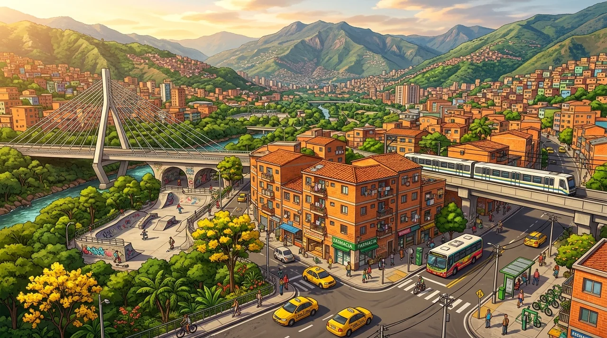
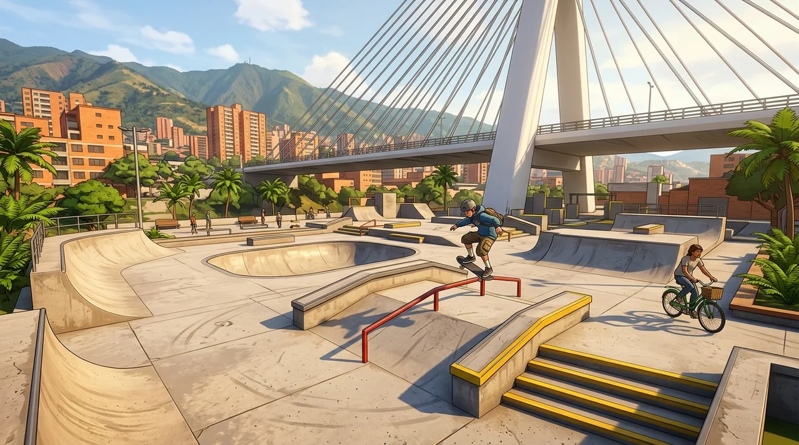
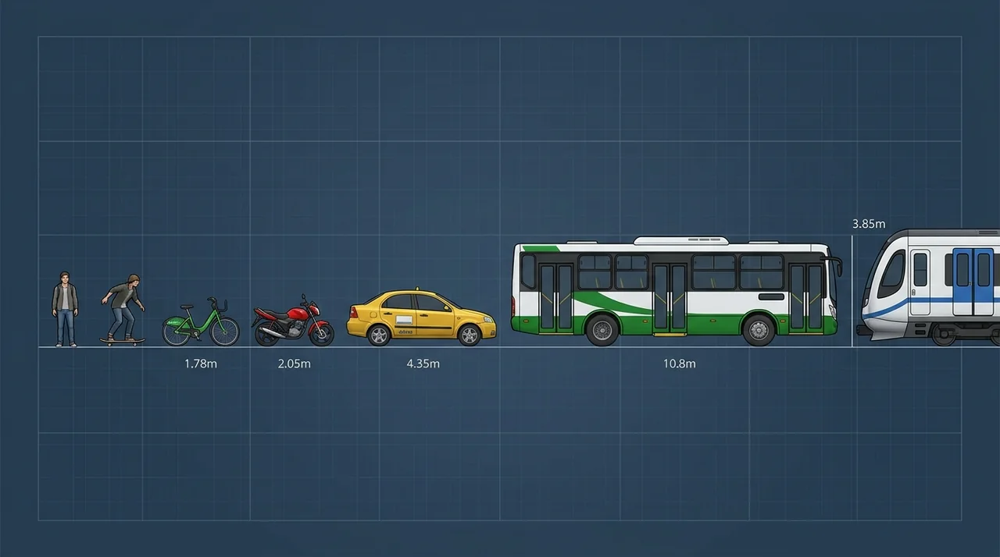
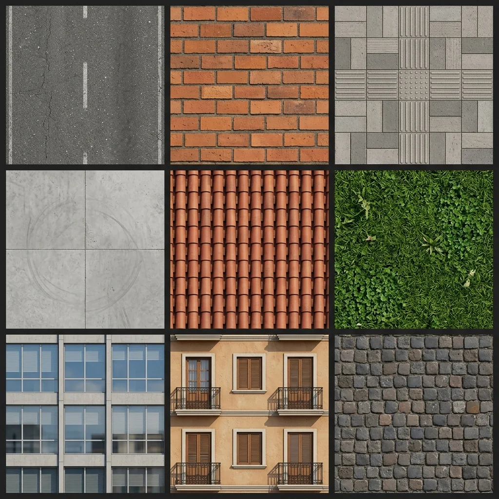
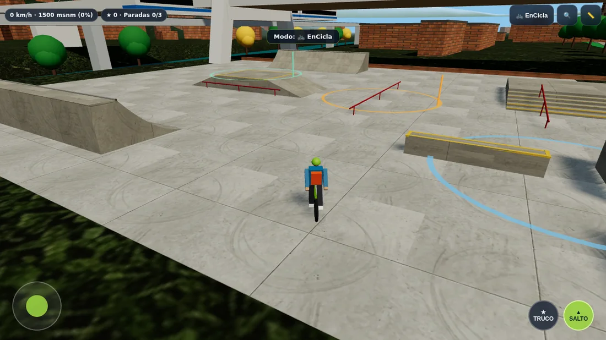
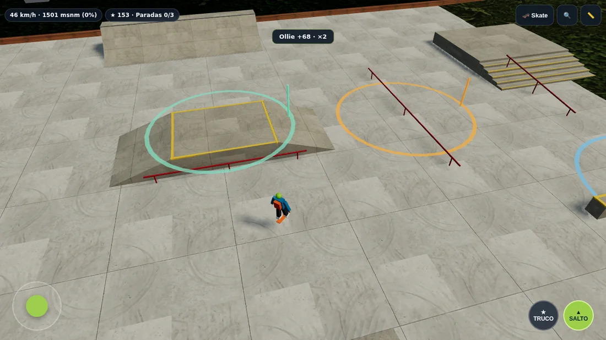
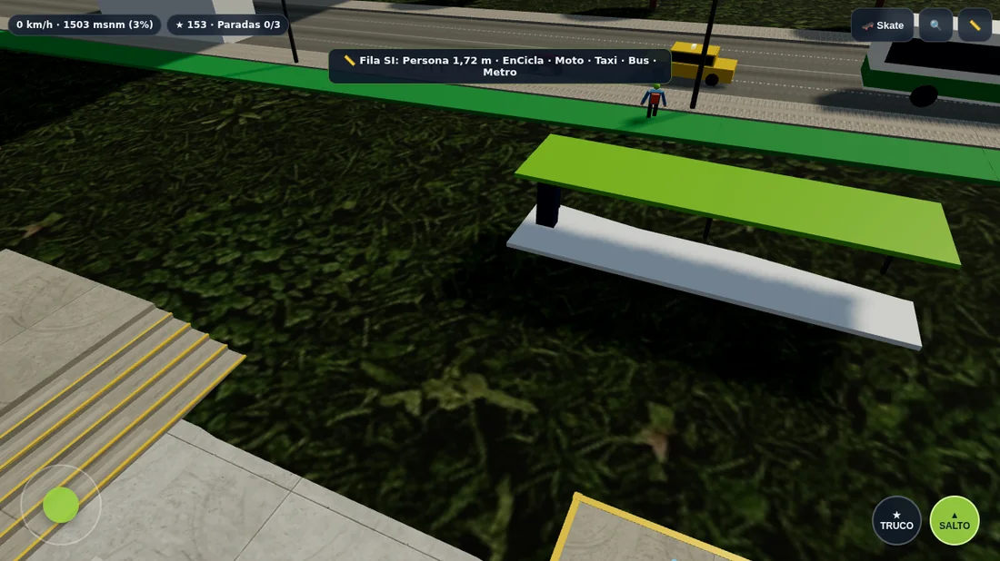
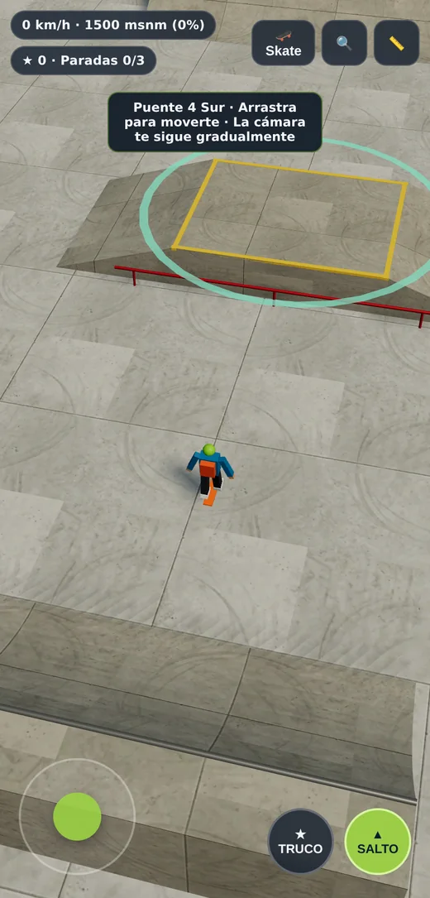

# Plan Maestro de Reconstrucción 3D · Motor City v6 («Efecto GTA · Medellín 1:1»)

> **Fecha:** 27 de noviembre de 2026  
> **Origen:** Directriz del autor tras la [`Auditoría Crítica y Forense`](./AUDITORIA-CRITICA-2026-11-27.md) del ecosistema (**Motor City**, **Turno Cero**, **Juega EnCicla**, **El Metro** y **Run Scooter**).  
> **Código base, datos reales, arte y prototipo jugable ya iniciados en este repositorio:** [`motor-v6/`](../motor-v6/) (ver [`motor-v6/README.md`](../motor-v6/README.md)).  
> **Planes hermanos publicados por repositorio:**  
> - Juega EnCicla: [`BicicletasUno/docs/PLAN-RECONSTRUCCION-3D-V6.md`](https://github.com/juanfeliperico369-stack/BicicletasUno/blob/main/docs/PLAN-RECONSTRUCCION-3D-V6.md)  
> - El Metro: [`MetroZero/docs/PLAN-RECONSTRUCCION-3D-V6.md`](https://github.com/juanfeliperico369-stack/MetroZero/blob/main/docs/PLAN-RECONSTRUCCION-3D-V6.md)  
> - Run Scooter: [`RunRunZero/docs/PLAN-RECONSTRUCCION-3D-V6.md`](https://github.com/juanfeliperico369-stack/RunRunZero/blob/main/docs/PLAN-RECONSTRUCCION-3D-V6.md)

---

## 1. Diagnóstico raíz: por qué volvemos a construir el mundo 3D desde cero

La auditoría forense comprobó con evidencia en código y en navegador móvil (`412 × 860`) que la arquitectura v1–v5 tocó su techo técnico y **no puede pulirse con más parches**:

| Problema estructural heredado (v5) | Impacto directo en la experiencia | Respuesta radical de **Motor 3D v6** |
|---|---|---|
| **30,12 MB en un solo HTML** (`getaway.html`) + **150 MB** en copias muertas de `motor-city/` + **276,5 MB** de heap en El Metro | Arranque lento, ahogo de memoria y carga incompleta del mundo al acercar (`45-tres.js:242` encoge a 140 m). | **Arquitectura híbrida «Efecto GTA»:** 12 Zonas Hero con medidas exactas (**~17–45 KB c/u**) + resto del valle **procedural en GPU (`InstancedMesh`, 0 bytes por edificio)** + carga offline por *assets* binarios livianos. |
| **Sin mundo 100 % 3D texturizado ni topografía real** | EnCicla es 2D con bloques borrosos `8 × 8`, El Metro pinta suelo 2D con tramado ajedrezado y el mobiliario 3D de Motor City ni siquiera se dibuja (`27-mobiliario.js`). | **Mundo 100 % 3D real** sobre malla continua de relieve SRTM (`terreno.js`) + **9 texturas PBR reales de Medellín (114 KB total)** + árboles, bancas, postes, viaductos y estaciones en 3D real. **Nada pintado en el suelo.** |
| **Cámara fija / incómoda al girar** | Cuando el jugador avanza en otra dirección respecto a la cámara, los controles se vuelven torpes y engorrosos. | **Cámara cenital única inteligente (`camara.js`):** movimiento relativo a la vista + **auto-seguimiento gradual** hacia donde mira y se desplaza el jugador + zoom continuo `72° → 34°` hasta casi tercera persona + *spring-arm*. |
| **Sin Skateparks 3D reales ni Parkour fluido** | Los trucos y paradas quedan rotos o planos; el movimiento a pie se siente rígido y sin inercia. | **5 Skateparks reales de Medellín** (*quarter-pipes*, *funbox*, barandas de *grind* magnético, escalas y Paradas de Trucos) + **Parkour** con *coyote time*, *jump buffer*, bóveda, trepado y rodada (`skatepark.js` + `personaje.js`). |
| **Escalas arbitrarias «a ojo»** | Personas gigantes frente a carros o buses aplastados, puertas fuera de proporción y mobiliario incoherente. | **Biblia de Escala SI estricta (`1 u = 1 m`)** en `escala.js`, validada automáticamente en cada prueba (`validarProporcionesSI()`). |
| **80–100 archivos concatenados con *monkey-patching*** | Un comentario `//` rompió la pausa en El Metro; `Ride.update` en EnCicla está envuelto 16 veces. | **Módulos ES nativos** (`import`/`export`), bucle físico fijo a 60 Hz, cero envoltorios en prototipos y pruebas sin teletransportes. |

---

## 2. Dirección visual y concepto objetivo («Efecto GTA · Medellín»)

El objetivo visual de **Motor 3D v6** no es copiar un mapa genérico, sino provocar **reconocimiento instantáneo de Medellín y el Valle de Aburrá** (el *Efecto GTA* que pidió el autor: que quien juegue sienta que ya estuvo en Puente 4 Sur, Plaza Botero, Parque Explora, Ciudad del Río o la Comuna 13).

### Lámina 1 · Visión objetivo 3D (Puente 4 Sur, Skatepark, viaducto del Metro, ladrillo paisa y montañas)

### Lámina 2 · Diseño de Skateparks 3D, barandas de grind, parkour y Paradas de Trucos

---

## 3. Arquitectura híbrida «Efecto GTA»: 12 Zonas Hero medidas + Valle completo genérico

La solución clave al peso del mundo es separar la ciudad en **dos capas continuas y sin costuras sobre el mismo relieve 3D real**:

1. **Capa Hero (12 Zonas Emblemáticas + 5 Skateparks Reales):**  
   Se reconstruyen con las **medidas reales exactas** extraídas de OpenStreetMap / Overture Maps, Catastro 3D de Medellín y elevación SRTM/NASA: anchos de avenidas, calles, carreras, ciclorrutas y escalas; número exacto de edificios y casas alrededor; alturas en metros y pisos reales; hitos arquitectónicos hechos a mano en 3D.
2. **Capa Genérica Procedural (todo el resto del Valle de Aburrá):**  
   Mantiene **navegable el 100 % del mapa del Valle** (de Caldas a Bello y de San Javier a Santo Domingo), pero fuera del radio Hero las manzanas, casas de ladera en ladrillo y torres residenciales se instancian por **semilla determinista en GPU (`THREE.InstancedMesh`, 2 *draw calls*)**, consumiendo **0 bytes de huellas estáticas**.

### Prueba empírica ya medida en `motor-v6/datos/`
- El slice real completo de la **Zona Hero #7 (Puente de la 4 Sur · `440 × 440 m`)**, con malla DEM SRTM `33 × 33`, **90 edificios reales** (huella, altura y ángulo exacto) y **31 polilíneas viales** pesa exactamente **16,7 KB** (`motor-v6/datos/hero-4sur.json`).
- Las **12 Zonas Hero completas** (5.407 edificios reales) pesarán en conjunto **~400–500 KB** en formato binario compacto — **más de 60 veces más liviano** que el HTML actual de 30,12 MB.

### Catálogo real medido de las 12 Zonas Hero y 5 Skateparks (`motor-v6/datos/zonas-hero-medellin.json`)

> Todos los datos de esta tabla fueron medidos directamente sobre el DEM SRTM y el catastro vial/edificado real del Valle de Aburrá (rango altitudinal cubierto: **1.454 msnm a 1.860 msnm — 406 m de relieve real**).

| # | Zona Hero (Comuna) | Relieve real (msnm · Δm · pend. máx) | Edificios / Casas reales | Altura prom. / máx. (pisos) | Vías medidas (anchos reales) | Hitos y Transporte | Skatepark 3D |
|---|---|---|---|---|---|---|---|
| 1 | **Centro · Plaza Botero y San Antonio** *(La Candelaria)* | 1.471–1.503 m · Δ **31,4 m** · 6,2 % | **550** (281 casas / 269 edif.) | 13,3 m / **95,1 m** (31 p.) | 60 seg. (Av. 10–21 m, Cll. 6–16 m, Ciclorr. 2,5 m) | Plaza Botero, Palacio Cultura, Coltejer · Metro A/B/T + 2 EnCicla | — |
| 2 | **Parque de las Luces, Alpujarra y Pies Descalzos** *(La Candelaria)* | 1.466–1.482 m · Δ **16,2 m** · 4,9 % | **137** (58 casas / 79 edif.) | 14,5 m / **73,8 m** (24 p.) | 95 seg. (Av. 7–21,5 m, Cra. 7–18 m, Escalas 3 m) | 300 postes luminosos, Bibl. EPM, Alpujarra · Metro A/B/MP1 + 4 EnCicla | — |
| 3 | **Parques del Río** *(Laureles / Conquistadores)* | 1.466–1.483 m · Δ **16,9 m** · 10,7 % | **98** (45 casas / 53 edif.) | 10,9 m / **37,2 m** (12 p.) | 79 seg. (Av. 10,5–21,5 m, Autop. 9–11,5 m, Ciclorr. 2,5 m) | Puente peatonal madera, soterrado río, terrazas · MP1 + 2 EnCicla | **Sí (#1)** |
| 4 | **Unidad Deportiva Atanasio Girardot · Estadio** *(Laureles-Estadio)* | 1.480–1.491 m · Δ **11,2 m** · 4,5 % | **305** (208 casas / 97 edif.) | 9,5 m / **55,5 m** (18 p.) | 42 seg. (Av. 7–15 m, Cll. 6–9 m, Ciclorr. 2,5 m) | Estadio Atanasio, Obelisco, ciclovías · Metro B + 2 EnCicla | **Sí (#2)** |
| 5 | **Distrito Cultural Norte · Explora, Botánico y Deseos** *(Aranjuez)* | 1.454–1.484 m · Δ **30,4 m** · 6,9 % | **256** (151 casas / 105 edif.) | 9,2 m / **55,5 m** (18 p.) | 78 seg. (Av. 14–15 m, Cra. 7–11,5 m, 37 escalas 3 m) | 4 cubos rojos Explora, Orquideorama, Planetario · Metro A + 3 EnCicla | **Sí (#3)** |
| 6 | **Ciudad del Río · MAMM** *(El Poblado / Industriales)* | 1.480–1.490 m · Δ **9,8 m** · 6,0 % | **162** (89 casas / 73 edif.) | 20,9 m / **98,2 m** (32 p.) | 30 seg. (Av. 14,5–15 m, Cra. 8–11 m, Ciclorr. 2,5 m) | MAMM, bodegas ladrillo, plazoleta · EnCicla Ciudad del Río | **Sí (#4)** |
| 7 | **Puente de la 4 Sur · Skatepark 4 Sur** *(El Poblado / Guayabal)* ★ *Vertical slice ya construido* | 1.496–1.520 m · Δ **24,1 m** · 8,1 % | **196** (56 casas / 140 edif.) | 13,1 m / **55,5 m** (18 p.) | 79 seg. (Av. 5,5–24,5 m, Autop. 5,5–14 m, 10 ciclorr.) | Puente atirantado Gilberto Echeverri, Río, Viaducto Metro · 2 EnCicla | **Sí (#5 · Activo)** |
| 8 | **El Poblado · Parque Lleras y Provenza** *(El Poblado)* | 1.534–1.583 m · Δ **49,3 m** · **11,1 %** | **476** (267 casas / 209 edif.) | 14,1 m / **95,1 m** (31 p.) | 48 seg. (Cll. 4–8,5 m, Av. 7–17 m, Peatonales 5 m) | Bulevar Provenza, Parque Lleras, torres entre árboles · 3 EnCicla | — |
| 9 | **Cerro Nutibara y Pueblito Paisa** *(Belén / Guayabal)* | 1.477–1.547 m · Δ **70,0 m** · **26,8 %** | **99** (59 casas / 40 edif.) | 11,2 m / **37,2 m** (12 p.) | 47 seg. (Cll. 4–14,5 m, 11 escalas 3 m) | Pueblito Paisa en la cima, Teatro Carlos Vieco, mirador 360° · MP1/MP2 | — |
| 10 | **Comuna 13 · Escaleras Eléctricas** *(San Javier)* | 1.590–1.660 m · Δ **70,0 m** · **22,4 %** | **933** (848 casas / 85 edif.) | 7,2 m / **28,1 m** (9 p.) | 64 seg. (Cll. 4–8 m, Peatonales 5 m, Escalas 3 m) | Escaleras eléctricas techadas, viaducto media ladera, murales | — |
| 11 | **Corredor Tranvía de Ayacucho** *(Buenos Aires)* | 1.506–1.533 m · Δ **27,2 m** · **9,6 %** | **645** (403 casas / 242 edif.) | 10,8 m / **86,0 m** (28 p.) | 40 seg. (Cll. 6–11,5 m, Cra. 7–10 m, Ciclorr. 2,5 m) | Tranvía en subida, Casa de la Memoria, Parque Bicentenario · Línea T + 2 EnCicla | — |
| 12 | **Santo Domingo Savio · Metrocable K** *(Popular)* | 1.670–1.860 m · Δ **190,0 m** · **47,3 %** | **1.550** (1.434 casas / 116 edif.) | 7,0 m / **18,9 m** (6 p.) | 60 seg. (Cll. 3–7,5 m, Cra. 7–10 m, Escalas 3 m) | Estación Metrocable K, Parque Biblioteca, mirador del Valle | — |
| **TOTAL** | **12 Zonas Hero emblemáticas** | **1.454–1.860 msnm (Δ 406 m)** | **5.407 edificaciones reales** | **7,0 – 98,2 m** | **760 segmentos viales medidos** | **Todos los modos integrados (Metro, Cable, Tranvía, Metroplús, EnCicla)** | **5 Skateparks 3D** |

---

## 4. Los 5 pilares técnicos ya codificados en `motor-v6/src/`

### 4.1 Topografía y relieve 3D real (`src/terreno.js`)
- Superficie 3D continua construida desde el DEM SRTM real (`getHeight(x, z)`, `getNormal(x, z)`, `getSlopePct(x, z)`), combinando el valle central, el cauce excavado del río Medellín con agua reflectante y los flancos andinos de la cordillera.
- **Cero edificios flotando en laderas:** cada edificio y casa se ancla con un zócalo subterráneo de `5 m` (Hero) o `6 m` (Genérico `InstancedMesh`), de forma que incluso en pendientes del **22–47 %** (Comuna 13, Nutibara, Santo Domingo) jamás queda un hueco bajo la fachada.
- Las vías principales y ciclorrutas siguen la pendiente real del terreno tramo a tramo (`rotation.x = -pendAng`).

### 4.2 Cámara cenital única inteligente con auto-seguimiento gradual (`src/camara.js`)
Resuelve de raíz el problema señalado por el autor (*«la cámara no permite moverse, lo cual provoca que cuando el jugador va en una dirección diferente a la cámara, resulten sus movimientos engorrosos»*):
1. **Control relativo a la cámara (`getMoveBasis()`):** empujar la palanca o `W` hacia arriba **siempre** mueve al personaje hacia adelante en pantalla, sin importar el ángulo cardinal.
2. **Auto-seguimiento gradual del rumbo:** mientras el jugador se desplaza (`rapidez > 0,65 m/s`), la cámara rota suave y exponencialmente detrás de su dirección de avance (zona muerta de 10°, amortiguación independiente de FPS, giro más ágil al ir rápido o estar cerca).
3. **Órbita manual sin pelea:** arrastrar con el dedo en pantalla (o `Q`/`E`) rota o inclina libremente la cámara, pausa el auto-seguimiento durante `1,65 s` para respetar el encuadre elegido y retoma suavemente al volver a avanzar.
4. **Curva continua `72° → 34°` de la misma cámara única:** rueda, pellizco o botón 🔍 acercan de forma continua desde cenital alta (`46 m`, lente 38°) hasta **casi tercera persona** (`9,2 m`, lente 56°, 34°), sin selectores de cámaras viejas.
5. **Spring-arm real + desvanecimiento alfa por edificio:** la cámara nunca atraviesa montañas ni fachadas; si un edificio queda entre el lente y el jugador, **solo ese edificio** baja suavemente a opacidad `0,28` (eliminando para siempre el tramado ajedrezado).

### 4.3 Biblia de Escala Real SI (`1 unidad = 1 metro`) (`src/escala.js`)

| Entidad | Largo (m) | Ancho (m) | Alto (m) | Referencia clave |
|---|---|---|---|---|
| **Persona adulta (Medellín)** | 0,30 fondo | 0,48 hombros | **1,72** | Ojos a 1,58 m · radio colisión 0,34 m |
| **Skate** | 0,80 | 0,21 | 0,12 | Persona sobre tabla: 1,84 m |
| **Patineta eléctrica (Scooter)** | 1,12 | 0,46 | 1,15 | Rueda Ø 0,22 m |
| **Bicicleta EnCicla** | **1,78** | 0,62 | 1,05 | Ruedas Ø 0,66 m · asiento 0,92 m |
| **Moto urbana** | **2,05** | 0,78 | 1,12 | Ruedas Ø 0,60 m · asiento 0,80 m |
| **Taxi / Sedán** | **4,35** | **1,78** | **1,46** | Más bajo que una persona de pie (1,72 m) |
| **Camioneta / SUV** | 4,95 | 1,94 | 1,82 | Rueda Ø 0,74 m |
| **Bus urbano / Alimentador** | **10,80** | **2,50** | **3,10** | 1,8× la estatura de una persona |
| **Metroplús articulado** | 18,00 | 2,55 | 3,25 | Carril vehicular estándar: 3,35 m |
| **Coche Metro (×1; tren ×3 = 70 m)** | **23,00** | **3,20** | **3,85** | Viaducto libre: **+6,80 m** sobre calle |

La función `validarProporcionesSI()` verifica automáticamente estas relaciones en `tests/verificar.mjs`: si algún módulo rompe el orden de tamaños o el ancho mínimo de carril, la compilación falla de inmediato.

### 4.4 Skateparks 3D reales, Paradas de Trucos y Parkour (`src/skatepark.js` + `src/personaje.js`)
- **Geometría transitable física real:** *quarter-pipes* parabólicos (`2,35 m` de alto con *coping* de acero e impulso `1,38×`), *funbox* central (`1,25 m`), escalas urbanas con filo amarillo, 3 barandas metálicas rojas con enganche magnético para **50-50 Grind / Boardslide**, muro de bóveda (`0,92 m`) y plataformas de trepado (`1,80 m`) con *gap* de salto.
- **Movimiento y game feel de Parkour + Skate + EnCicla:**
  - Paso físico fijo a **60 Hz** (independiente de los FPS del dispositivo).
  - *Coyote time* (**120 ms**) y *jump buffer* (**140 ms**): los saltos se sienten responsivos y justos.
  - **Auto-bóveda (*vault*)** al saltar cerca de obstáculos de `0,45–1,25 m` y **trepado (*ledge mantle*)** hasta `2,35 m`, más **deslizamiento (*slide*)** y **rodada de aterrizaje** en caídas > `2,20 m`.
  - **Sistema de Trucos y Paradas jugables:** Ollie, Kickflip, Shuvit, 360 Flip, 50-50 Grind, Bóveda y Trepado con multiplicador de combo y **3 Paradas de Trucos** por skatepark que validan el truco requerido sobre el obstáculo real.

### 4.5 Atlas de texturas PBR reales de Medellín (`src/texturas.js` + `arte/texturas/`)

Las 9 teselas `256 × 256` sin costuras extraídas y empaquetadas en `motor-v6/arte/texturas/` pesan solo **114 KB en total** (frente a 1,78 MB en blobs Base64 del motor viejo):
`asfalto.webp` (15 KB), `ladrillo_paisa.webp` (13 KB), `anden_medellin.webp` (10 KB), `concreto_skatepark.webp` (4 KB), `teja_barro.webp` (12 KB), `pasto_valle.webp` (28 KB), `fachada_vidrio.webp` (5 KB), `fachada_residencial.webp` (11 KB) y `adoquin_plaza.webp` (16 KB) — todas con respaldo procedural automático en Canvas si se abre sin servidor.

---

## 5. Evidencia real del prototipo `motor-v6/demo.html` ya funcionando

Verificado con `node motor-v6/tests/verificar.mjs` (`RESULTADO MOTOR-V6: OK`) y probado en vivo en **Google Chrome headless** (desktop `1280 × 720` y móvil `412 × 860`):
- **0 errores de consola**, **0 errores de página**, **0 recursos 404**.
- **72 edificios Hero reales** (OSM/Catastro) + **390 edificios genéricos GPU** (`InstancedMesh`) + **42 árboles 3D** + **Puente de la 4 Sur** + **viaducto y tren Metro animado de 3 coches** + **Skatepark 4 Sur** + **fila de calibración SI**.
- Auto-seguimiento gradual verificado en movimiento real (`camYaw` rotó `-0,932 rad` suavemente detrás del giro `W+D`), truco `Ollie +68 · ×2` y **cero solapamiento de HUD en móvil** (`chipPtsBottom: 72 px < avisoTop: 88 px`).

| Vista casi 3.ª persona · EnCicla, Puente 4 Sur, Viaducto Metro y edificios reales | Acción en Skatepark 4 Sur · Ollie ×2, rampas con concreto PBR y auto-seguimiento |
|---|---|
|  |  |

| Fila de calibración SI 1:1 (Persona 1,72 m vs Taxi, Bus y Estación EnCicla) | Móvil `412 × 860` · HUD de 5 controles sin solapamientos y sombras reales |
|---|---|
|  |  |

---

## 6. Hoja de ruta completa por fases (Fases 0 a 6)

| Fase | Alcance y entregables | Juegos beneficiados | Compuerta de salida (verificación honesta) |
|---|---|---|---|
| **Fase 0** *(Completada hoy)* | Plan maestro en los 4 repos + Biblia SI + catálogo medido de **12 Zonas Hero / 5 Skateparks** + 4 láminas de arte + 9 texturas PBR (114 KB) + slice vertical jugable **Puente 4 Sur** en `motor-v6/`. | Todos (núcleo compartido) | `verificar.mjs` 100 % verde + Chrome desktop/móvil `0` errores + capturas reales auditadas píxel a píxel. |
| **Fase 1 · Empaquetador y Streaming de Zonas** | Exportador Python/Node que genera los 12 paquetes compactos (`hero-*.bin/json`, ~20–45 KB c/u) + cargador asíncrono por proximidad (`r < 420 m`) con transición invisible a la malla genérica `InstancedMesh` + PWA offline sin HTML gigante. | Motor v6 + los 4 juegos | Memoria JS `< 110 MB` recorriendo 5 km continuos; carga de cada Zona Hero `< 25 ms` sin tirones; `0` copias muertas de 50 MB en repos hermanos. |
| **Fase 2 · Tráfico SI, Peatones y Conducción Física** | Módulo `vehiculos.js` (carro, moto inclinable, bus, EnCicla, tren Metro, tranvía, cable) en escala SI exacta con física compartida (suspensión, derrape, colisión deslizante, reversa) + tráfico real por carril y **Guardián de Sonido (P8)** obligatorio. | Turno Cero, EnCicla, El Metro, Run Scooter | Conducción real por bot sin teletransporte; silencio 100 % al ocultar pestaña; 60 Hz física estable. |
| **Fase 3 · Las 5 Zonas con Skatepark + Circuito de Trucos y Parkour** | Construir los hitos 3D propios de **Puente 4 Sur**, **Ciudad del Río (MAMM)**, **Parques del Río**, **Estadio Atanasio** y **Distrito Norte (Explora/Botánico)** con sus **5 Skateparks** y **15 Paradas de Trucos** jugables. | EnCicla, Run Scooter, Turno Cero | Completar 15/15 paradas de trucos y parkour por navegación real; `0` vallas invertidas, `0` edificios sobre plazas o canchas. |
| **Fase 4 · Las 7 Zonas Hero Restantes y Laderas Extremas** | Construir **Centro/Plaza Botero**, **Alpujarra/Luces**, **Lleras/Provenza**, **Cerro Nutibara/Pueblito Paisa**, **Comuna 13 (Escaleras Eléctricas)**, **Tranvía de Ayacucho** y **Santo Domingo (Metrocable K)** sobre el relieve real de 406 m. | El Metro, EnCicla, Turno Cero | Subida en Metrocable K (+190 m, 47,3 %) y recorrido por Comuna 13 (933 casas) con `0` edificios flotantes y ≥ 45 FPS en `412 × 860`. |
| **Fase 5 · Migración de los 4 Juegos sobre un Único Motor v6** | Conectar las capas de juego limpias (sin duplicar el motor): **Juega EnCicla** (turismo + 3 oficios + skateparks), **El Metro** (conducción + ciudad libre + despacho), **Run Scooter** (ciclovía con relieve + paradas en skatepark) y **Turno Cero** (campaña 18+ en `motorcity` únicamente). Conservar migradores de guardado (`elmetro.v1`, `juega_encicla_*`). | Todos | Un solo paquete `motor-v6` consumido por los 4 juegos; `0` errores en navegador en vertical y horizontal (P10); cada juego con HUD ≤ 6 controles y botones ≥ `44 × 44 px`. |
| **Fase 6 · Pulido Final, Pruebas en Celular Físico y Fase F** | Calibración táctil en celular real con GPU, audio espacial por bioma (río, tren, plaza, skatepark), optimización de sombras y ejecución de **Fase F** (lámina de apertura/cierre de EnCicla) solo cuando el autor confirme. | Todos | Prueba de mano en celular físico aprobada por el autor; `p95 < 25 ms` (≥ 40–60 FPS reales) y 0 bloqueadores. |

---

## 7. Reglas inquebrantables de ingeniería para Motor 3D v6

1. **Un solo motor de verdad:** ningún repositorio hermano vuelve a guardar copias muertas de 50 MB ni a escribir su propio renderizador 3D paralelo.
2. **Prohibido el *monkey-patching*:** jamás envolver funciones globales en cadena (`orig = X.prototype.update`). Toda nueva mecánica se diseña como módulo ES con interfaz explícita.
3. **Pruebas honestas (cero teatro):** queda prohibido aprobar pruebas de jugabilidad teletransportando al jugador a la meta o reportando `Math.round(1000/ms)` sin techo de 60 FPS. Toda compuerta valida movimiento real, cero solapamientos de HUD y capturas reales.
4. **Respeto a los modos 2D/Pixel:** el 2D y el pixel quedan exclusivamente en los modos retro/portada/fichas ya establecidos, jamás como respaldo borroso del mundo 3D principal.
5. **Propiedad intelectual y tono:** español de Colombia, todo público (Turno Cero 18+ aislado en `motorcity`), sin logos oficiales ni marcas registradas de terceros y sin nombres internos de IAs visibles para el jugador.
