# Reporte Técnico y Visual V4: Revolución Visual de los Biomas y el Modo Arcade
**Identificación oficial:** `Gemini Antigravity — Motor City V4`  
**Fecha:** `2026-11-23`  
**Rama:** `ia/antigravity/v4-paralaje-biomas` (base `origin/main` `f1510e1`, Motor City `4.9.0`)  
**Encargo:** [Issue #14 — GEMINI ANTIGRAVITY — MOTOR CITY 4.9+ · MISIÓN V4](https://github.com/juanfeliperico369-stack/motorcity/issues/14)

---

## 1. Síntesis de lectura obligatoria (5 líneas)

1. **Un solo mundo 3D para todas las cámaras:** Motor City `4.9.0` y *Turno Cero* mantienen un único mundo físico y vial (`MC.Mundo` en ciudades y `MC.Planeta` + `Generador.carretera` en las autopistas de 7 biomas de `js/13-planeta.js`) que todas las vistas (`VistaTres`, `VistaGL`, cenital y `MC.Arcade` en `js/47-clasicos.js`) proyectan sin duplicar estado, tráfico ni coordenadas.
2. **Evolución 4.7 → 4.9:** En `4.8` y `4.9`, Claude integró `⚙️ Flexibilidad`, el renderizador `MC.VistaTres` (three.js r128 MIT incrustado offline con sombras solares y ventanas nocturnas) y los 17 pedidos de ChatGPT (`docs/PEDIDOS-CHATGPT-4.9.md`), dejando lista la base para renovar los horizontes y biomas de `MC.Arcade`.
3. **Arquitectura de `MC.Arcade` y empaquetado:** `MC.Arcade` (`js/47-clasicos.js:119-280`) proyecta la carretera real por segmentos estilo *OutRun* y calcula iluminación/niebla con `cieloRetro(E)`, mientras que `herramientas/construir.mjs` ensambla todos los `js/NN-*.js` en orden alfabético exigiendo cero comentarios `//` de una sola línea.
4. **Implementación V4:** Creamos las 18 texturas originales `1024 × 256` RGBA WebP sin costuras (`6 biomas × 3 capas`: `lejos`, `medio`, `cerca`) junto con `arte/arcade/biomas/manifiesto.json` y el módulo aditivo `js/47-paralaje-biomas.js` (`MC.ParalajeBiomas`), que inserta el paralaje detrás de la calzada, lo entinta con el sol/noche/niebla del motor, limita la memoria con una caché LRU de `2` biomas, reduce capas en dispositivos lentos y cae al respaldo procedural si falta un asset o en `llanura`.
5. **No interferencia absoluta con Codex y Claude:** Todos los cambios viven en archivos nuevos de nuestra rama (`arte/arcade/biomas/*`, `js/47-paralaje-biomas.js`, `pruebas/paralaje-biomas.mjs`, `docs/PLAN-V4-PARALAJE-GEMINI.md`, `reportes/gemini-v4-paralaje-biomas.md`), con **0 líneas modificadas** en `js/45-tres.js`, `js/45-gl.js`, `js/47-clasicos.js`, `arte/fachadas/medellin/`, `geo/territorio.py`, `datos/medellin/mundo.mc4` y `juegos/getaway/60-modos.js`.

---

## 2. Catálogo verificado de las 18 texturas (`1024 × 256` RGBA WebP)

Todas las texturas fueron generadas en sala limpia con supersampling `2×` (`2048 × 512 → 1024 × 256` Lanczos), funciones armónicas periódicas en `2π·x / 1024` y codificación WebP RGBA lossless exacta (`exact=True`), logrando **`costura_mae = 0.0000`** en las 18 capas y un peso total en disco de **`335.79 KB` (`343,848 bytes`)**:

| ID | Bioma | Capa | Dimensiones | Velocidad | Peso (KB) | Bytes | Transp. (%) | Opacidad (%) | Costura MAE | Color medio RGB | SHA-256 (16) |
|---|---|---|---:|---:|---:|---:|---:|---:|---:|---|---|
| `costa_lejos` | `costa` | `lejos` | `1024×256` | `0.12` | `11.03` | `11,298` | `39.4 %` | `60.6 %` | `0.0000` | `[79, 128, 152]` | `24cd36fc1acb511e` |
| `costa_medio` | `costa` | `medio` | `1024×256` | `0.35` | `25.10` | `25,702` | `57.9 %` | `42.1 %` | `0.0000` | `[96, 129, 87]` | `86fd10f6b1a5c886` |
| `costa_cerca` | `costa` | `cerca` | `1024×256` | `0.70` | `36.30` | `37,168` | `73.9 %` | `26.1 %` | `0.0000` | `[132, 138, 95]` | `148af54cea1b0f5f` |
| `desierto_lejos` | `desierto` | `lejos` | `1024×256` | `0.12` | `12.58` | `12,878` | `38.8 %` | `61.2 %` | `0.0000` | `[168, 120, 88]` | `eeb1cec260c03d30` |
| `desierto_medio` | `desierto` | `medio` | `1024×256` | `0.35` | `17.31` | `17,726` | `55.9 %` | `44.1 %` | `0.0000` | `[188, 138, 86]` | `e8dd96c01830a13f` |
| `desierto_cerca` | `desierto` | `cerca` | `1024×256` | `0.70` | `12.64` | `12,942` | `78.7 %` | `21.3 %` | `0.0000` | `[153, 120, 73]` | `be7a36db3093d0fc` |
| `bosque_lejos` | `bosque` | `lejos` | `1024×256` | `0.12` | `13.04` | `13,350` | `31.8 %` | `68.2 %` | `0.0000` | `[66, 108, 95]` | `2ce8e81c83f67cd9` |
| `bosque_medio` | `bosque` | `medio` | `1024×256` | `0.35` | `20.92` | `21,418` | `56.9 %` | `43.1 %` | `0.0000` | `[54, 100, 61]` | `24f9479f877724b4` |
| `bosque_cerca` | `bosque` | `cerca` | `1024×256` | `0.70` | `18.37` | `18,808` | `74.2 %` | `25.8 %` | `0.0000` | `[51, 91, 50]` | `b75ce2c2961f2b53` |
| `montana_lejos` | `montana` | `lejos` | `1024×256` | `0.12` | `16.62` | `17,020` | `26.2 %` | `73.8 %` | `0.0000` | `[91, 102, 115]` | `88585a9d35c11462` |
| `montana_medio` | `montana` | `medio` | `1024×256` | `0.35` | `18.45` | `18,888` | `52.5 %` | `47.5 %` | `0.0000` | `[89, 104, 76]` | `493156a5b57aff99` |
| `montana_cerca` | `montana` | `cerca` | `1024×256` | `0.70` | `18.16` | `18,594` | `77.6 %` | `22.4 %` | `0.0000` | `[86, 99, 68]` | `d0edbefdd4a682e0` |
| `nieve_lejos` | `nieve` | `lejos` | `1024×256` | `0.12` | `18.30` | `18,738` | `25.4 %` | `74.6 %` | `0.0000` | `[183, 196, 214]` | `635f189c1726bd80` |
| `nieve_medio` | `nieve` | `medio` | `1024×256` | `0.35` | `24.42` | `25,008` | `58.6 %` | `41.4 %` | `0.0000` | `[184, 196, 208]` | `8cac0fb41923c7c4` |
| `nieve_cerca` | `nieve` | `cerca` | `1024×256` | `0.70` | `24.00` | `24,572` | `79.6 %` | `20.4 %` | `0.0000` | `[182, 193, 202]` | `5671d9b49b036079` |
| `lagos_lejos` | `lagos` | `lejos` | `1024×256` | `0.12` | `12.17` | `12,458` | `35.0 %` | `65.0 %` | `0.0000` | `[76, 115, 117]` | `e2500e84450dcdd8` |
| `lagos_medio` | `lagos` | `medio` | `1024×256` | `0.35` | `18.00` | `18,436` | `61.2 %` | `38.8 %` | `0.0000` | `[77, 125, 77]` | `1660e0bb42ea6e45` |
| `lagos_cerca` | `lagos` | `cerca` | `1024×256` | `0.70` | `18.40` | `18,844` | `78.2 %` | `21.8 %` | `0.0000` | `[67, 108, 63]` | `2801f69101206b62` |

---

## 3. Verificación de repetición horizontal 3× sin costuras

Cada vista previa concatena `3` repeticiones horizontales consecutivas (`x ∈ [0, 3072)`) de las capas `lejos`, `medio`, `cerca` y la composición superpuesta:

### 3.1 Costa tropical (`costa`)
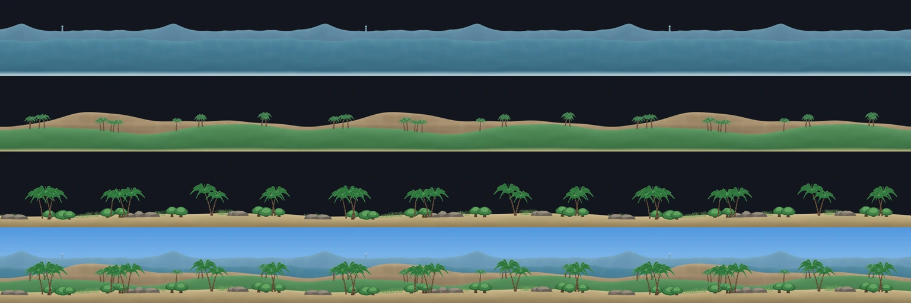

### 3.2 Desierto (`desierto`)
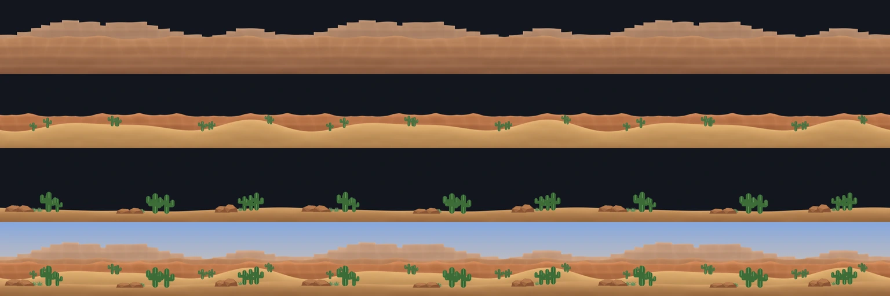

### 3.3 Bosque andino (`bosque`)
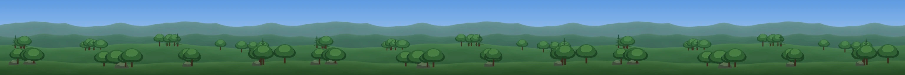

### 3.4 Montaña (`montana`)
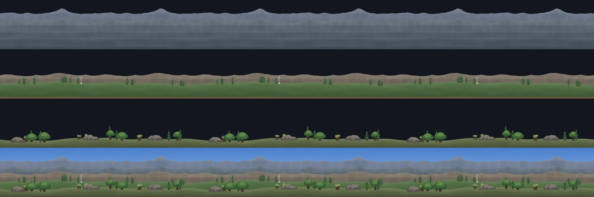

### 3.5 Nieve (`nieve`)
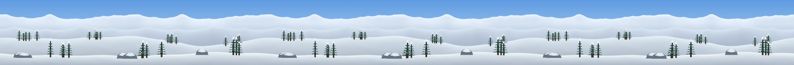

### 3.6 Lagos (`lagos`)
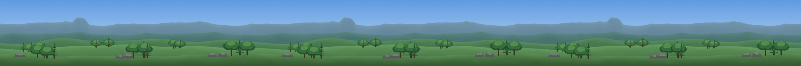

---

## 4. Comparativa visual Antes (procedural) vs Después (Paralaje V4) en `MC.Arcade`

### 4.1 Vista móvil vertical `412 × 860` (6 biomas, día `10:30`)

| Bioma | Antes (montañas procedurales 4.9.0) | Después (Paralaje 3 capas V4) |
|---|---|---|
| **`costa`** (`ruta_atlantico`, `y = 1800`) | 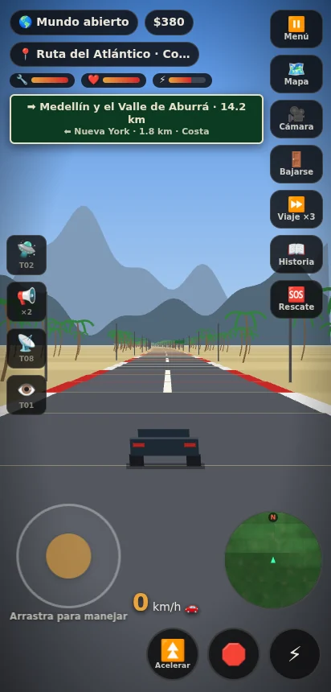 | 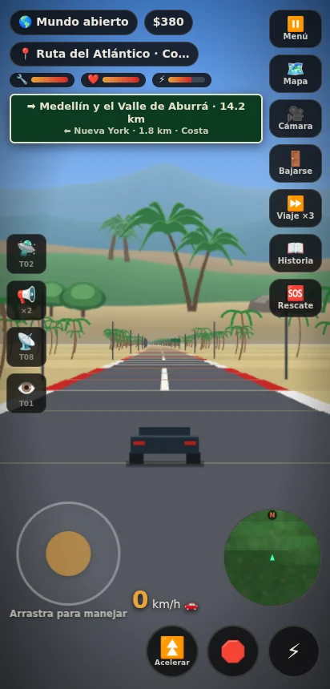 |
| **`desierto`** (`ruta_atlantico`, `y = 10000`) | 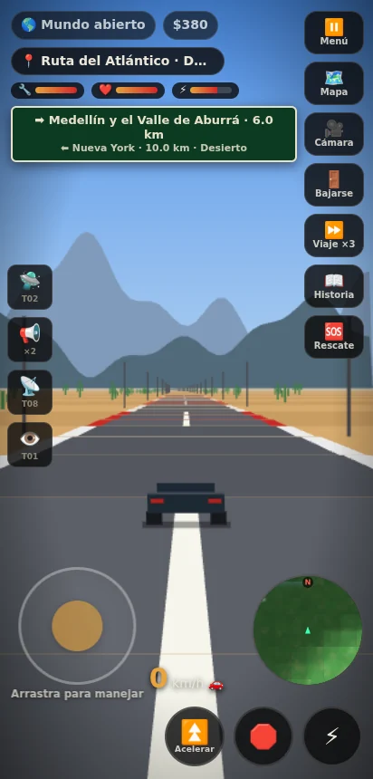 | 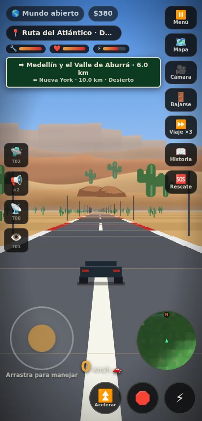 |
| **`bosque`** (`ruta_embalse`, `y = 6000`) | 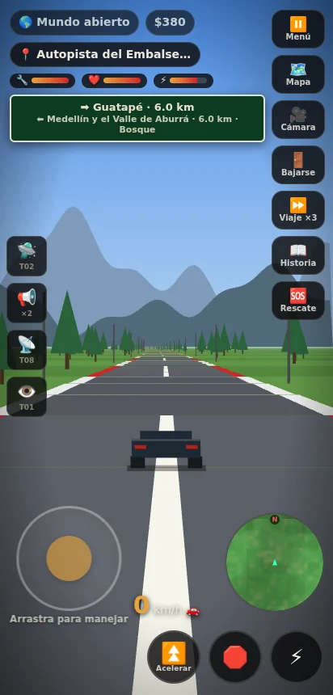 | 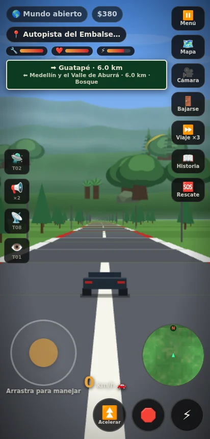 |
| **`montana`** (`ruta_atlantico`, `y = 14000`) | 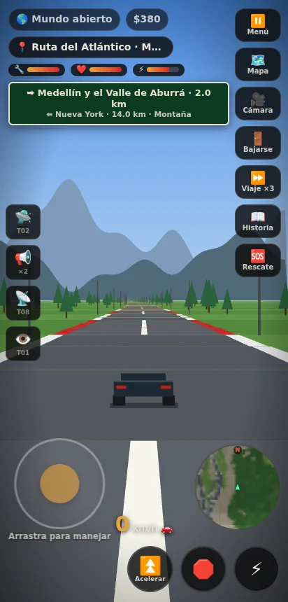 | 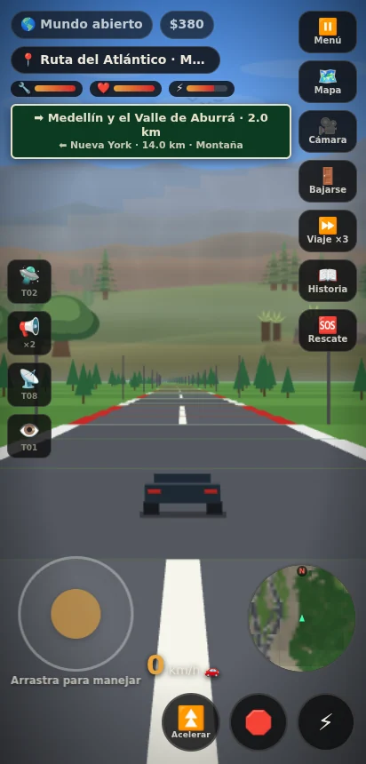 |
| **`nieve`** (`ruta_norte`, `y = 9400`) | 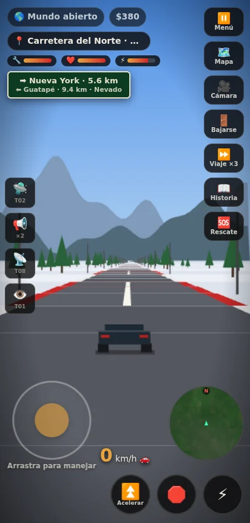 | 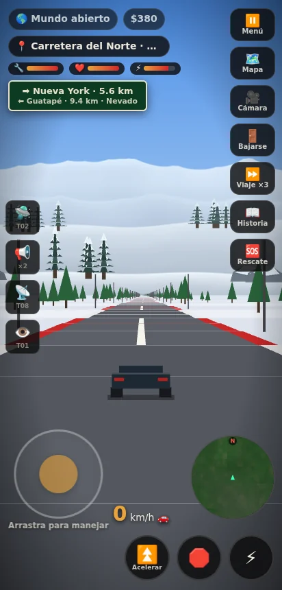 |
| **`lagos`** (`ruta_embalse`, `y = 10200`) | 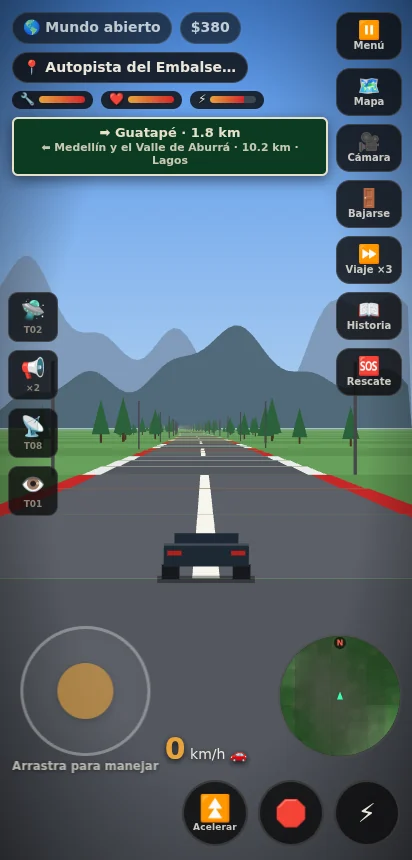 | 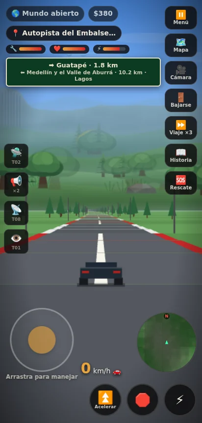 |

### 4.2 Ciclo Día / Noche y vista horizontal `860 × 412`

| Bioma | Día (`860 × 412`, `10:30`) | Noche (`860 × 412`, `21:00`) | Noche móvil (`412 × 860`, `21:00`) |
|---|---|---|---|
| **`costa`** | 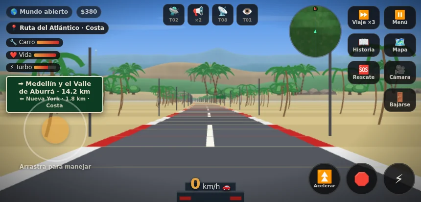 | 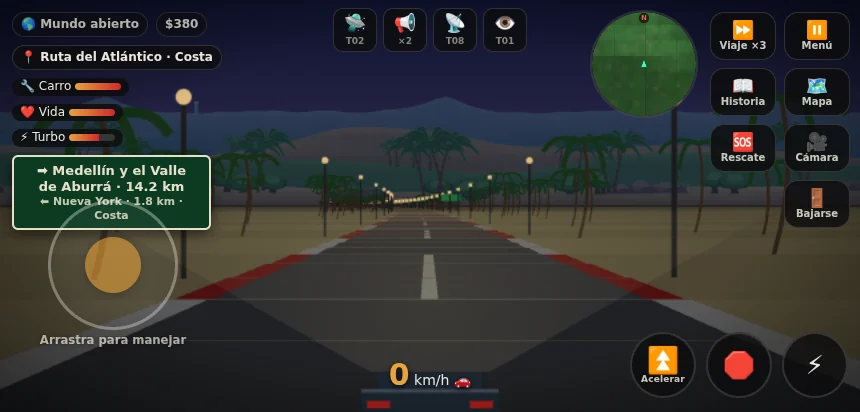 | 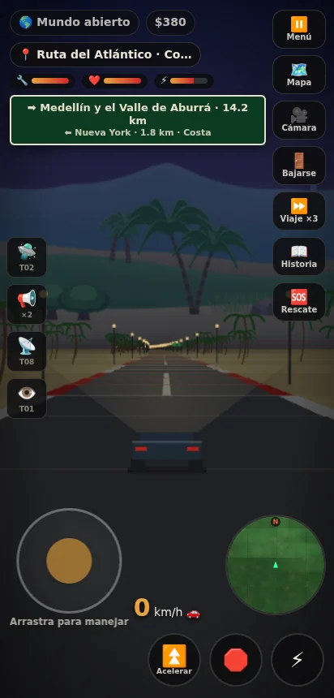 |
| **`montana`** | 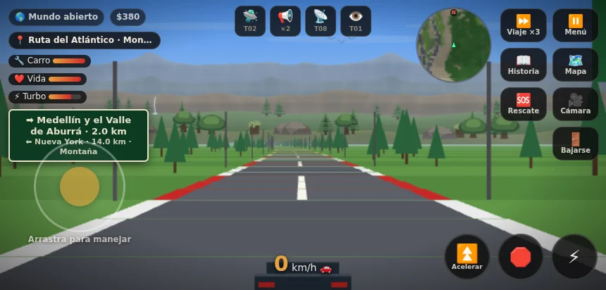 | 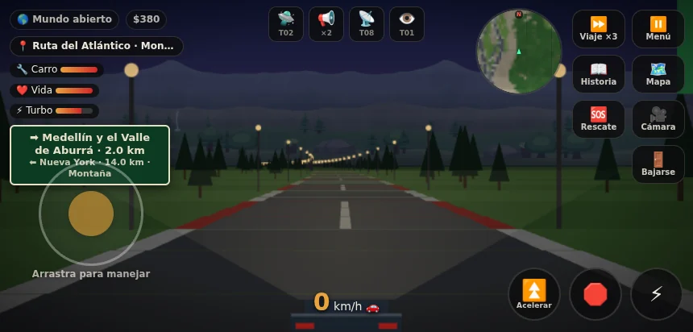 | 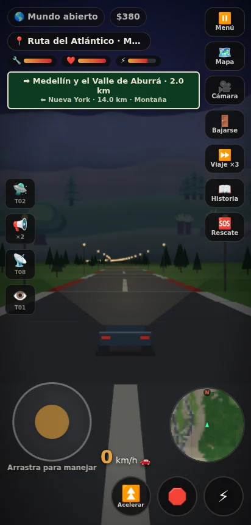 |
| **`nieve`** | 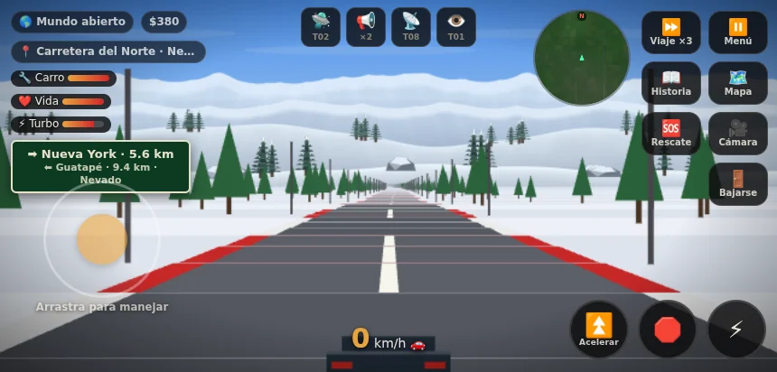 | 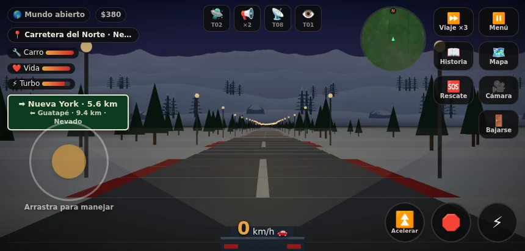 | 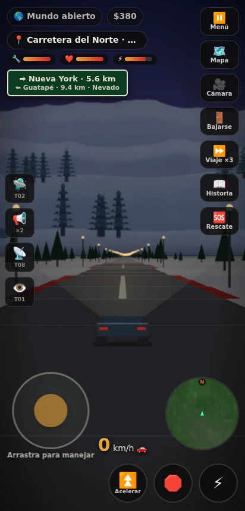 |

---

## 5. Telemetría, memoria y resultados de las 5 suites obligatorias

### 5.1 Métricas por bioma en `pruebas/paralaje-biomas.mjs`

| Bioma | Ruta real (`MC.Planeta`) | `y` (m) | `mismoMundo` | Capas activas | Draw calls | `difHorizonte` (RGB) | `% Horizonte cambiado` | `difCalzada` (RGB) | Respaldo procedural |
|---|---|---:|---|---:|---:|---:|---:|---:|---|
| **`costa`** | `ruta_atlantico` | `1800` | `true` | `3` | `5` | `25.05` | `66.0 %` | `0.2556` | `false` |
| **`llanura`** | `ruta_atlantico` | `5800` | `true` | `0` | `0` | `0.00` | `0.0 %` | `0.0000` | `true` (esperado) |
| **`desierto`** | `ruta_atlantico` | `10000` | `true` | `3` | `5` | `37.43` | `70.6 %` | `0.2302` | `false` |
| **`montana`** | `ruta_atlantico` | `14000` | `true` | `3` | `8` | `40.78` | `82.0 %` | `0.3551` | `false` |
| **`bosque`** | `ruta_embalse` | `6000` | `true` | `3` | `6` | `35.49` | `73.6 %` | `0.2518` | `false` |
| **`lagos`** | `ruta_embalse` | `10200` | `true` | `3` | `10` | `37.42` | `76.6 %` | `0.1887` | `false` |
| **`nieve`** | `ruta_norte` | `9400` | `true` | `3` | `3` | `53.84` | `98.1 %` | `0.3565` | `false` |

### 5.2 Impacto en tamaño, arranque y memoria
- **Peso de las 18 texturas WebP en disco:** `335.79 KB` (`343,848 bytes`).
- **Impacto en `dist/juegos/getaway.html` (HTML único offline):** `26,093 KB → 26,568 KB` (`+475 KB`, **`+1.82 %`**).
- **Tiempo al primer cuadro jugable (`msPrimerCuadro`):** `3,078 ms` (sin bloqueo; decodificación diferida por bioma).
- **Caché LRU acotada:** `lruMax = 2` biomas residentes (`imgsEnCache = 6` imágenes `1024×256`), `10` expulsiones limpias al recorrer los 6 biomas, `usedJSHeapSize = 132.6 MB`.
- **Degradación de calidad y respaldo ante fallo:**
  - `calidad = 0.50` → `capasMedia = 2` (`lejos` + `cerca`).
  - `calidad = 0.30` → `capasBaja = 0`, `fbBaja = true` (respaldo procedural).
  - Eliminación temporal de `costa_medio` → `fbEliminado = true`, `cieloNoNegro = true`, y restauración inmediata (`restauradoOk = true`) al recuperar el recurso.
  - `0` errores de consola/página y `0` peticiones de red externas.
